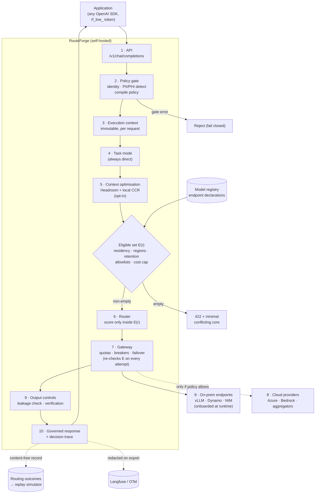

# RouteForge

RouteForge is a **self-hostable, OpenAI-compatible model router and policy gateway**.
Applications send normal chat-completion requests with an API token; for every call
RouteForge runs a privacy gate first (PII/PHI detection + redaction + a residency
decision), then routes the call to the cheapest model/backend allowed by that
application's policy, verifies the output, records usage, and returns a standard
`ChatCompletion` **plus a decision trace** describing what it did and why. Sensitive
requests never leave on-prem when policy says so.

It implements steps 1–10 of the Unified LLM Orchestration architecture — the **Serving
Plane** — and delivers three guarantees:

1. **Privacy-first** — sensitive requests never leave the customer's infrastructure.
2. **Cost reduction** — two independent levers: per-call routing to cheap/local models,
   and Headroom context compression (60–95% fewer tokens on tool outputs).
3. **Observable** — every decision is captured in Langfuse via RouteForge's own
   OpenTelemetry exporter.

**RouteForge is a pure router.** It points at OpenAI-compatible endpoints and deploys,
scales, or load-balances **no** inference itself — operators stand up their own serving
(vLLM/Dynamo/NIM/any OpenAI-compatible server) and onboard it at runtime. The Improvement
Plane (training, evaluation, promotion) is **orchestrated, not hosted**: RouteForge can
capture training substrate, trigger an external job and onboard the result, but runs no
training or inference compute itself.

**Paper and artifact:** *Eligibility-Constrained LLM Routing: When the Candidate Pool Is a
Per-Request Variable* — source, PDF and data in
[`docs/research/paper/`](docs/research/paper/); the version that accompanies it is tag
[`arxiv-v1`](https://github.com/mani-mal/routeForge/tree/arxiv-v1). Code is Apache-2.0
([`LICENSE`](LICENSE)); see [`CITATION.cff`](CITATION.cff) to cite it.

## Architecture

Every call an application makes — including each call of a client-side agent loop —
passes through the same ten steps. The policy gate runs first; the **eligible set** of
endpoints is derived from the compiled application policy and the operator's endpoint
declarations *before* any scoring, and an empty set rejects the request instead of
falling through to the nearest alternative.



| Step | What it decides | Module |
|---|---|---|
| 1 / 10 | OpenAI-compatible request in; response plus a per-step decision trace out | `app/api/routes.py` |
| 2 | Who is calling, what sensitive entities the request carries, the app's compiled policy — **runs first, fails closed** | `app/policy/gate.py`, `app/policy/compile.py` |
| 3 | An immutable execution context that travels with the request | `app/policy/context.py` |
| 4 | Task mode — always `direct`; agent loops belong to the calling application | `app/routing/task_mode.py` |
| 5 | Whether to compress tool outputs/history (after the gate, never before) | `app/compression/` |
| 6 | Which eligible endpoint serves the call (scored on post-compression cost) | `app/routing/router.py`, `app/policy/feasible.py` |
| 7 / 8 | Quotas, circuit breakers, failover; calls to onboarded on-prem or enabled cloud endpoints | `app/gateway/` |
| 9 | Output leakage checks and verification, client-output redaction | `app/output/verify.py` |

More detail: [`docs/architecture/`](docs/architecture/) (logical and request-flow notes,
tier selection, sample request flows) and the draw.io sources in
[`docs/architecture/diagrams/`](docs/architecture/diagrams/).

## How RouteForge differs from other LLM routers

There are many good routers and gateways. Most answer **"which model is best (or
cheapest) for this request?"** over a pool they treat as fixed. RouteForge answers a prior
question first — **"which endpoints may see this request at all?"** — and only then
optimises. It is a policy-and-eligibility layer for regulated, self-hosted deployments,
not a better model-quality predictor.

| Category | Examples | Primary job |
|---|---|---|
| Gateways / proxies | [LiteLLM](https://github.com/BerriAI/litellm), [Portkey](https://github.com/Portkey-AI/gateway), [Kong AI Gateway](https://developer.konghq.com/ai-gateway/), [Envoy AI Gateway](https://github.com/envoyproxy/ai-gateway), [Bifrost](https://github.com/maximhq/bifrost), [Helicone](https://github.com/Helicone/helicone) | One API over many providers: keys, budgets, rate limits, load balancing, fallback, guardrails, logging |
| Hosted routing services | [OpenRouter](https://openrouter.ai/docs/features/provider-routing), [Cloudflare AI Gateway](https://developers.cloudflare.com/ai-gateway/), [Not Diamond](https://www.notdiamond.ai/), [Azure Foundry model router](https://learn.microsoft.com/en-us/azure/foundry/openai/concepts/model-router), [Bedrock Intelligent Prompt Routing](https://docs.aws.amazon.com/bedrock/latest/userguide/prompt-routing.html) | Managed provider/model selection, often price- or quality-driven |
| Learned / semantic routers | [RouteLLM](https://github.com/lm-sys/RouteLLM), [LLMRouter](https://github.com/ulab-uiuc/LLMRouter), [NVIDIA NeMo Switchyard](https://github.com/NVIDIA-NeMo/Switchyard), [vLLM Semantic Router](https://github.com/vllm-project/semantic-router), [NVIDIA LLM Router blueprint](https://github.com/NVIDIA-AI-Blueprints/llm-router) | Predict which model will answer well enough, from the prompt, embeddings, classifiers or execution signals |

**Already common — RouteForge does not claim these as unique:** an OpenAI-compatible API;
self-hosting; retries, fallback and circuit breakers; per-key/team budgets and rate
limits; PII masking before the provider (e.g. LiteLLM + Presidio, Kong AI Sanitizer);
region filtering (LiteLLM pre-call checks, Azure data zones); zero-data-retention
filtering (OpenRouter); OpenTelemetry/Langfuse export. RouteForge itself uses LiteLLM as its
provider-call library behind the gate.

**What RouteForge adds** (we found no equivalent documented in the products above as of
October 2026; that is a statement about their documentation, not a proof of absence):

1. **Eligibility before scoring, as one fail-closed seam.** Each request's eligible set is
   computed from the application's *compiled* policy (placement, allowed regions,
   no-retention, tier/provider/model allowlists, cost cap) **and** the operator's
   per-endpoint declarations (region, prompt retention, acceptance of raw sensitive
   text). Every scorer, retry and failover stays inside it; if it is empty the request is
   rejected, never sent to "the closest" endpoint.
2. **Detection changes *where* a request may run, not just what it says.** A detected
   SSN or PHI entity can raise placement to `onprem_only` for that request (declared,
   raise-only sensitivity rules), in addition to redaction. `onprem_only` removes cloud
   endpoints from the candidate pool before anything is scored.
3. **Placement and protection are separate, property-tested axes.** Residency (where
   compute runs) is independent of what the model sees, what the client receives, what
   telemetry stores and which detector runs; one compiler resolves them, and a Hypothesis
   harness checks that neither axis can move the other (it found two fail-open defects).
4. **Rejections explain themselves.** An empty eligible set returns a 422 naming the
   *minimal conflicting set* of requirements, with endpoint state kept separate and hints
   that never suggest relaxing a security requirement.
5. **Policy changes can be tested before they are applied.** Every request writes a
   content-free outcome record (no prompt or completion text); an offline simulator
   replays recorded traffic through the production router under a proposed policy and
   reports routes changed, requests newly rejected, cost and capacity effects, with
   bootstrap ranges.
6. **Evaluation that respects policy.** FeasibleRouteBench scores routers against an
   oracle that never credits an endpoint the request was not allowed to use.
7. **Restrictions that follow an agent.** An opt-in trajectory envelope carries detected
   entity types across an agent's calls, so a compacted summary of restricted context
   does not drift to a cloud endpoint; attempt-scoped and service tokens bound what a
   single agent run can do.
8. **Recomputable decisions.** Each routing hop records every eligible candidate's
   scoring terms with the source of each value (measured, peer prior, tier default), so
   a ranking can be recomputed offline.

**Where others are stronger:** learned routers (RouteLLM, LLMRouter, Switchyard, Not
Diamond, Azure model router) predict answer quality far better than RouteForge's
length-based tier rule, and full gateways (LiteLLM, Portkey, Kong) cover far more providers
and enterprise features. RouteForge is designed to compose with them: its eligible set is
the boundary inside which any scoring strategy may run. The trade-offs, measured, are in
the paper ([`docs/research/paper/`](docs/research/paper/)) and in
[`docs/architecture/decisions/`](docs/architecture/decisions/).

## Quick start (local, single node)

Regex PII detection and an in-container SQLite store make a local bring-up need no GPU,
no API keys, and no network.

```bash
docker compose -f deploy/compose/docker-compose.yml up --build
```

Brings up the API (`:8080`), the console UI (http://localhost:3001), and a self-hosted
Langfuse stack (http://localhost:3000, login `demo@example.com` / `demodemo`).

Then, because the on-prem pool **boots empty**:

1. Open the console, sign in to the admin dashboard (`admin@routeforge.local` /
   `changeme` — change these for anything real).
2. **Onboard a model**: Infrastructure → Onboard, or `POST /admin/infra/models`, pointing
   at your own OpenAI-compatible endpoint. RouteForge probes it and only enables it if it's
   reachable. See [`docs/guides/onboarding-models.md`](docs/guides/onboarding-models.md).
3. **Create an application** and issue its `rf_live_…` token, then call the OpenAI-compatible
   API:

```bash
curl http://localhost:8080/v1/chat/completions \
  -H "Authorization: Bearer rf_live_…" \
  -H "Content-Type: application/json" \
  -d '{"model": "auto", "messages": [{"role": "user", "content": "hello"}]}'
```

Optional load tooling (product tooling, not the product): synthetic-persona traffic for
exercising every branch —

```bash
python -m tests.traffic --requests 500 --rps 10 --seed 42
```

## Onboarding a model and an application (step by step)

Worked example: the DGX lab deployment (namespace `runai-routeforge`, API at
`http://10.89.195.201:30808`) and a vLLM model `qwen3.8-27b` served at
`http://10.89.195.201:30859/v1` that needs a bearer key. Substitute your own names; the
steps are the same for any OpenAI-compatible endpoint. Field reference:
[`docs/guides/onboarding-models.md`](docs/guides/onboarding-models.md).

### 1. Log in as admin

```bash
RF=http://10.89.195.201:30808          # your RouteForge API
curl -s -c cookies.txt -H "Content-Type: application/json" \
  -d '{"email":"<ADMIN_EMAIL>","password":"<ADMIN_PASSWORD>"}' "$RF/admin/login"
```

On Kubernetes the login is in Secret `routeforge-admin`:
`kubectl -n runai-routeforge get secret routeforge-admin -o jsonpath='{.data.ADMIN_PASSWORD}' | base64 -d`
(same for `ADMIN_EMAIL`). Steps 3–6 send `-b cookies.txt`.

### 2. Put the model's key in an environment variable on the RouteForge API

Skip this if the endpoint needs no key. RouteForge never stores a model key: at
onboarding you give it the **name** of an environment variable (`api_key_env`), and the
API reads the key from its own environment on every call. So the variable must exist in
the **API container**, not in your shell.

**Kubernetes** — when you have the key in hand:

```bash
read -rsp "qwen3.8-27b key: " QWEN38_API_KEY; echo     # typed, not echoed or saved in history
echo "${#QWEN38_API_KEY} characters"                     # must be non-zero; prints only the length

# create-or-replace: safe to re-run (plain `create` fails with "already exists")
kubectl -n runai-routeforge create secret generic qwen38-key \
  --from-literal=QWEN38_API_KEY="$QWEN38_API_KEY" \
  --dry-run=client -o yaml | kubectl apply -f -
unset QWEN38_API_KEY

# first time only: wire the secret into the API as an env var (restarts the pod)
kubectl -n runai-routeforge set env deploy/routeforge-api --from=secret/qwen38-key
kubectl -n runai-routeforge rollout status deploy/routeforge-api
```

When you **replace** the key later, skip `set env` (the variable is already wired) and
restart instead — a pod reads Secret-backed variables only when it starts:
`kubectl -n runai-routeforge rollout restart deploy/routeforge-api`.

If the key already lives in a Secret in the model's namespace (for example
`qwen38-secrets` / `vllm-api-key` in `runai-glm-coding`), copy it across without
printing it:

```bash
kubectl -n runai-routeforge create secret generic qwen38-key \
  --from-literal=QWEN38_API_KEY="$(kubectl -n runai-glm-coding get secret qwen38-secrets \
      -o jsonpath='{.data.vllm-api-key}' | base64 -d)" \
  --dry-run=client -o yaml | kubectl apply -f -
```

Check the variable is set and non-empty (prints only its length; `0` means an empty
key, and the onboarding probe will fail with a 401):
`kubectl -n runai-routeforge exec deploy/routeforge-api -- sh -c 'echo ${#QWEN38_API_KEY}'`

`kubectl set env` changes the live Deployment only. Also add the variable to the
manifest you deploy from, or the next `kubectl apply` removes it — on the DGX lab that is
`deploy/dgx_lab/routeforge-app.yaml`, next to `GLM_FLASH_API_KEY`:

```yaml
          - name: QWEN38_API_KEY
            valueFrom: {secretKeyRef: {name: qwen38-key, key: QWEN38_API_KEY, optional: true}}
```

With the Helm chart, put the same entry under `extraEnv` in your values file.

**Docker Compose** — add the key to `deploy/compose/.env` (never committed):

```bash
read -rsp "qwen3.8-27b key: " K; echo; printf 'QWEN38_API_KEY=%s\n' "$K" >> deploy/compose/.env; unset K
```

then pass it through to the container under `services.api.environment` in
`deploy/compose/docker-compose.yml`:

```yaml
      QWEN38_API_KEY: ${QWEN38_API_KEY}
```

and recreate the API: `docker compose -f deploy/compose/docker-compose.yml up -d api`.

### 3. Onboard the model

```bash
curl -s -b cookies.txt -X POST -H "Content-Type: application/json" \
  -d '{
        "slug": "qwen3.8-27b",
        "display_name": "Qwen3.8 27B",
        "tier": "mid",
        "endpoint": "http://qwen38.runai-glm-coding:8000/v1",
        "api_key_env": "QWEN38_API_KEY",
        "price_input": 10,
        "price_output": 10,
        "context_window": 262144,
        "region": "us-lab",
        "prompt_retention": "none",
        "accepts_raw_sensitive": true
      }' \
  "$RF/admin/infra/models"
```

- `slug` must equal the id the server reports (vLLM's `--served-model-name`; check with
  `curl -H "Authorization: Bearer <key>" <endpoint>/models`). It cannot be renamed —
  delete and onboard again.
- `api_key_env` is the variable's **name**. Pasting the key itself sends no auth header,
  the probe gets a 401 and the model shows as unreachable.
- `endpoint` must be reachable from the API pod. In-cluster, use the short
  `<service>.<namespace>` form — on the DGX lab, full `.svc.cluster.local` names resolve
  to a corporate wildcard. A NodePort URL (`http://10.89.195.201:30859/v1`) also works.
- `tier` is `cheap | mid | frontier`. Prices are USD per 1M tokens; for on-prem models
  they are nominal and turn an app's `max_spend_usd_per_day` into a token budget.
- Onboarding is probe-gated and needs no restart. The console route is Infrastructure →
  Onboard a model.

Verify: `curl -s -b cookies.txt "$RF/admin/infra/models"` shows the model enabled and
healthy, and `curl -s "$RF/health"` lists it. Edit with `PUT $RF/admin/infra/models/<slug>`
(full replace, re-probes); remove with `DELETE` on the same path.

### 4. Create an application

```bash
curl -s -b cookies.txt -X POST -H "Content-Type: application/json" \
  -d '{"id":"my-app","name":"My app","default_residency":"onprem_only"}' \
  "$RF/admin/applications"
```

The response contains the application's first `rf_live_…` token. **It is shown once** —
RouteForge stores only a hash. Use one application per consumer: limits, usage and the
Langfuse project belong to the application, and all its tokens share them.

### 5. Restrict the application to specific models

```bash
curl -s -b cookies.txt -X PUT -H "Content-Type: application/json" \
  -d '{
        "allowed_providers": ["onprem"],
        "allowed_models": ["qwen3.8-27b"],
        "residency": "onprem_only",
        "max_rpm": 30,
        "max_spend_usd_per_day": 20.0
      }' \
  "$RF/admin/applications/my-app/policy"
```

The policy `PUT` merges — omitted fields keep their stored values — but `allowed_models`
is replaced as a whole, so list every model the application should keep. To add a model
to an existing application: `-d '{"allowed_models": ["glm-5.3-flash", "qwen3.8-27b"]}'`.

### 6. Tokens

```bash
curl -s -b cookies.txt -X POST -H "Content-Type: application/json" \
  -d '{"name":"laptop"}' "$RF/admin/applications/my-app/tokens"     # new token, shown once
curl -s -b cookies.txt -X POST "$RF/admin/tokens/<token_id>/revoke"
```

### 7. Call the model as the application

```bash
export ROUTEFORGE_BASE_URL="$RF/v1"
export ROUTEFORGE_API_KEY="rf_live_..."

curl -s "$ROUTEFORGE_BASE_URL/models" -H "Authorization: Bearer $ROUTEFORGE_API_KEY"
curl -s "$ROUTEFORGE_BASE_URL/chat/completions" \
  -H "Authorization: Bearer $ROUTEFORGE_API_KEY" -H "Content-Type: application/json" \
  -d '{"model":"qwen3.8-27b","messages":[{"role":"user","content":"Say hello"}]}'
```

Any OpenAI SDK works with `base_url=$ROUTEFORGE_BASE_URL` and `api_key=$ROUTEFORGE_API_KEY`.
`"model": "auto"` lets RouteForge choose among the models the application may use. A 422
naming the model means the application's policy does not allow it (step 5). Requests that
carry `tools` come back buffered rather than streamed token by token (backlog B58).

## Two auth domains (read this first)

RouteForge has **two completely separate credentials**; mixing them up is the most common
onboarding mistake.

| Credential | Who holds it | What it opens |
|---|---|---|
| **App token** `rf_live_…` (`Authorization: Bearer`) | Your application | `POST /v1/chat/completions`, `GET /health` |
| **Admin session cookie** `rf_admin_session` | A human admin (dashboard) | `/admin/*` management, `/api/*` console (history, stats, live decision SSE) |

An app token **cannot** call `/admin/*` or `/api/*`, and an admin cookie is **not** used
for inference. See [`docs/guides/admin-setup.md`](docs/guides/admin-setup.md) and
[`docs/guides/agentic-app-guide.md`](docs/guides/agentic-app-guide.md) for the full admin +
developer onboarding path, and [`docs/reference/api-reference.md`](docs/reference/api-reference.md)
for the exact HTTP contract.

## Deployment

| Target | Artifact |
|---|---|
| Single node (local / small) | `deploy/compose/docker-compose.yml` |
| Kubernetes / HPE GreenLake | `deploy/helm/serving-plane` (`values-greenlake.yaml`) |
| HPE Private Cloud AI (Ezmeral) | `deploy/hpe/` packaged chart |

See the `greenlake-deploy` skill for storage class, ingress, registry, and air-gapped
considerations.

## Configuration

Four single-owner YAMLs under `config/`, env-var overridable, cross-validated at boot by a
config lint that fails closed on any drift (duplicated concern, unpriced model, unknown
tier, provider-name mismatch):

| File | Owns |
|---|---|
| `serving.yaml` | Infrastructure switches: compression infra, observability, provider on/off, server |
| `policy.yaml` | Budgets, the sensitivity enum + default, residency, tenants |
| `routing.yaml` | Scoring weights, thresholds, the canonical `tiers` list, cloud `model_pool`, escalation |
| `pricing.yaml` | Per-model USD/1M and the savings baseline |

On-prem models are **not** declared in YAML — they're onboarded at runtime and live in the
`ModelRegistry` (cloud YAML pool ∪ enabled onboarded rows). If no on-prem model is enabled,
`onprem_only` requests are **rejected**, never silently sent to cloud.

## Context compression (Headroom)

Off by default so you can measure before/after. Enable with
`context_optimization.enabled: true`. It compresses tool outputs, logs, and history before
the LLM call; the CCR cache keeps originals **locally** for retrieval. Two rules that
matter: compression runs *after* the policy gate (never before), and the CCR cache must
stay inside the residency boundary. See the `headroom-compression` skill.

## Working with Claude Code

`CLAUDE.md` is the anchor — read it first. Skills in `.claude/skills/` carry area-specific
constraints:

| Skill | Covers |
|---|---|
| `privacy-gate` | Steps 2–3: Presidio, redaction, fail-closed, redaction map |
| `headroom-compression` | Step 5: Headroom, CCR residency, bypass rules |
| `routing-and-gateway` | Steps 6–8 (+ step-4 task mode): scoring, adapters, confidence |
| `output-controls` | Step 9: leakage checks, `require_verification`, streaming policy |
| `inference-backends` | What an operator runs behind an onboarded on-prem endpoint (vLLM/Dynamo/TensorRT-LLM); owns the full Dynamo skills list |
| `demo-ui` | Console: flow visualizer, decision inspector, cost dashboard |
| `traffic-and-tests` | Synthetic personas, generator, test suite (product load tooling) |
| `greenlake-deploy` | Docker, Helm, HPE GreenLake |

NVIDIA also publishes Dynamo skills — install them rather than reinventing. The full list
lives in the `inference-backends` skill (single source); read it before any Dynamo work.

## Notes

- All PII in the synthetic personas is fake (Faker). Never load real customer data into them.
- Headroom is Apache 2.0 and runs locally; no data leaves the machine.
- No secrets in code or compose. `.env` only; `.env.example` is committed.
