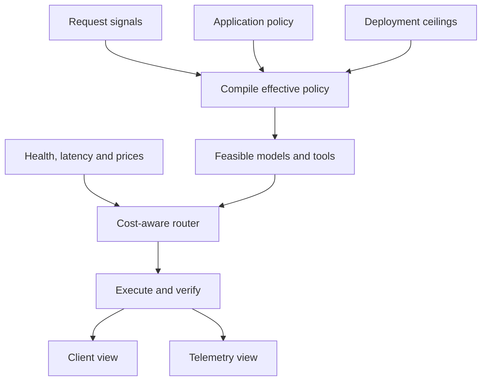
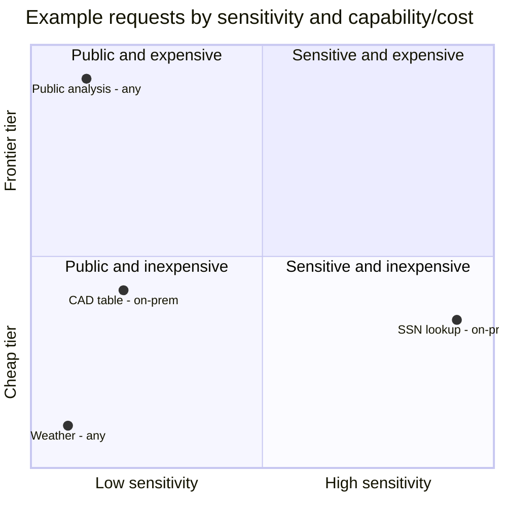
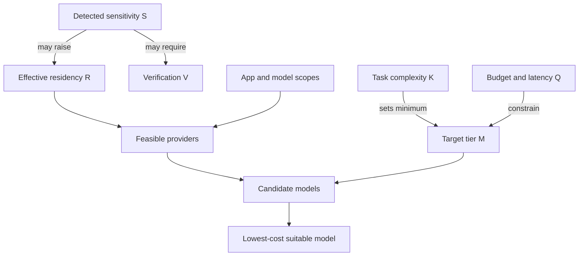

# RouteForge Multidimensional Policy and Routing Model

## Purpose

RouteForge cannot be understood accurately with a single setting such as **strict**, **private**, or **cheap**. A request may simultaneously be:

- Highly sensitive
- Required to stay on-premises
- Simple enough for a cheap model
- Allowed to use a trusted tool with raw identifiers
- Required to return a redacted answer
- Forbidden from storing prompt or response content in telemetry

These are separate decisions. This document presents RouteForge as a multidimensional policy and routing system, first with a simple three-axis model and then with a fuller policy vector.

This is a conceptual guide, not a statement that every described independent control is already implemented.

> **Status (reviewed 2026-10-20).** When this guide was written, the implementation still coupled several dimensions through `policy_mode`. Since P1a (PR #52) they are compiled as separate axes by `compile_policy` in `app/policy/compile.py`, and `policy_mode` is only a preset. Today: residency `R`, model input `I`, client output `O`, telemetry `T` (`capture_io`), detection, context transformation `C` (`content_integrity`) and streaming/verification `V` are independent per-app axes, and P1b (PR #56) added the endpoint data-handling declarations behind the feasible set (§10). **Tool access `G` (§5.3) is not built** as a separate axis: tool-call arguments are classified and redacted with the model view, but no per-tool, per-entity grant exists. For the shipped field reference see [`../reference/per-app-config.md`](../reference/per-app-config.md). The handoff that identified the original gaps is archived and no longer tracked in the repository.

---

## 1. The shortest mental model

RouteForge performs two different jobs:

1. **Policy compilation:** determine what is legally and operationally allowed.
2. **Routing optimization:** choose the best model from what remains allowed.



The router must never optimize across an illegal choice. It first removes models, tools, and data paths that violate policy. It then optimizes cost, latency, and capability inside the remaining feasible set.

Conceptually:

```text
Feasible set = healthy models
             ∩ model-to-application scope
             ∩ application allowlists
             ∩ residency-permitted providers
             ∩ permitted tiers and models
             ∩ budget and quota constraints

Chosen model = lowest-cost suitable model in the feasible set
```

If the feasible set is empty, RouteForge rejects the request. It must not silently relax residency or protection.

---

## 2. The core three-axis model

The most useful first visualization has three axes:

| Axis | Meaning | Low end | High end |
|---|---|---|---|
| **X: Data sensitivity** | What sensitive information the request contains | Public/no detected PII | Restricted/high-impact PII |
| **Y: Residency strictness** | Where computation is allowed to run | Any approved provider | On-premises only |
| **Z: Capability and cost tier** | How capable and expensive the selected model is | Cheap | Frontier |

### X axis: data sensitivity

This is primarily derived from the request, not selected directly by the user.

Conceptual scale:

```text
X0 Public       No sensitive entity detected
X1 Confidential Names, email, phone, location, date, or similar entities
X2 Restricted   SSN, medical identifier, card/bank identifier, or another high-impact entity
```

This axis measures **severity**, not simply the number of matches. One SSN can be more consequential than ten person names.

Important limitation:

> No detected PII does not prove that no PII exists.

If detection is off, downgraded, misconfigured, or bypassed by `passthrough`, a request containing an SSN may incorrectly appear to be `X0`.

### Y axis: residency strictness

This axis comes from the application's placement contract and may be raised by request classification.

```text
Y0 Any approved location
Y1 Approved private cloud
Y2 On-premises only
```

The effective residency is conceptually:

```text
effective residency = stricter(application floor, request-derived floor)
```

Examples:

- An application configured as `onprem_only` remains on-prem even for a public question.
- An application configured as `any` may be raised to `onprem_only` when an SSN is detected.
- A request-level rule can make placement stricter, never weaker than the application floor.

Residency controls **where execution may occur**. It does not determine whether the prompt is raw or redacted, whether telemetry stores content, or what the client receives.

### Z axis: model capability and cost tier

This axis is the router's serving choice:

```text
Z0 Cheap
Z1 Mid
Z2 Frontier
```

Task complexity, quality requirements, risk rules, and allowed tiers determine the minimum suitable tier. Price and latency then help choose a model within that permitted tier.

High sensitivity does not automatically mean a frontier model is required. A simple SSN lookup may be restricted and on-premises but still use a cheap or mid-tier model. Conversely, a complex public research problem may contain no PII and still need a frontier model.

### Example coordinates

The numeric coordinates below are conceptual labels, not configuration values.

| Request | X: Sensitivity | Y: Effective residency | Z: Likely tier | What this demonstrates |
|---|---:|---:|---:|---|
| “What is the capital of France?” | X0 | Y0 | Z0 | Public, cloud-eligible, cheap |
| “Draft an email to Jane at jane@example.com” | X1 | Y1 | Z0–Z1 | Moderate PII may affect placement without requiring frontier capability |
| “Find the ticket for SSN 123-45-6789” | X2 | Y2 | Z0–Z1 | High sensitivity and strict residency can still be inexpensive |
| “Analyze this public 300-page technical standard” | X0 | Y0 | Z2 | High capability/cost with low PII |
| “Summarize this proprietary CAD table exactly” | X0 | Y2 | Z1 | Low PII, on-prem placement, exact-data requirements |

The following view flattens the cube onto X and Z. The residency value in each label supplies the third coordinate:



The cube is useful because it prevents three common mistakes:

- Treating a higher model tier as more private
- Treating on-prem placement as automatic redaction
- Treating more PII as automatically requiring a more expensive model

---

## 3. Three dimensions are not enough

The core cube explains sensitivity, placement, and serving cost, but it cannot answer:

- Does the model see the real SSN?
- Can a trusted tool use the SSN?
- Is the final answer redacted?
- Does Langfuse store raw, redacted, or no content?
- Can streaming release tokens before verification?
- Can Headroom rewrite the prompt or tool history?

RouteForge is better represented as a policy vector:

```text
RouteForge decision vector

P = ⟨S, R, K, M, I, G, O, T, V, C, Q⟩
```

| Symbol | Dimension | Question |
|---|---|---|
| `S` | Sensitivity | What sensitive content was detected? |
| `R` | Residency | Where may execution occur? |
| `K` | Task complexity | How difficult is the request? |
| `M` | Model tier | Which capability/cost tier serves it? |
| `I` | Model-input exposure | What representation may the model see? |
| `G` | Tool access | What representation may each tool see? |
| `O` | Client-output policy | What representation may the caller receive? |
| `T` | Telemetry exposure | What content may observability systems store? |
| `V` | Verification and delivery | When and how may output be released? |
| `C` | Context transformation | May compression rewrite context or must content remain exact? |
| `Q` | Operational constraints | What budget, rate, latency, and availability limits apply? |

The rest of this document explains each dimension.

---

## 4. Request-derived dimensions

### 4.1 Sensitivity `S`

Sensitivity is calculated from detected entities and ordered privacy rules. It should be treated as a request property, not a permanent label on the application.

Typical outcomes:

| Detected content | Conceptual sensitivity | Possible consequences |
|---|---|---|
| Nothing | Public | Any placement allowed unless app floor is stricter |
| Name/email/phone | Confidential | Private-cloud floor, medium risk, output checking |
| SSN/medical/card/bank ID | Restricted | On-prem floor, high risk, mandatory verification |

Custom recognizers can add customer-specific entities such as medical record numbers.

### 4.2 Task complexity `K`

Complexity is separate from sensitivity.

```text
K0 Simple       Short factual or formatting request
K1 Moderate     Reasoning, synthesis, or a controlled tool call
K2 Complex      Long-context, multi-step, or difficult reasoning
```

Complexity helps determine the target model tier. A public request can be complex, and a restricted request can be simple.

### 4.3 Runtime signals

Some routing inputs change from moment to moment:

- Model health
- Queue depth
- Latency
- Circuit-breaker status
- Provider availability
- Remaining daily budget
- Current RPM quota
- Token estimate

These signals should influence selection only after policy has established the feasible set.

---

## 5. Configured hard-constraint dimensions

### 5.1 Residency `R`

Residency is a hard placement constraint:

| Value | Meaning | Router behavior |
|---|---|---|
| `any` | Any enabled and permitted provider | Cloud and on-prem candidates may remain |
| `private_cloud_ok` | Approved private-cloud providers | Public/unapproved providers removed |
| `onprem_only` | Customer-controlled infrastructure only | Cloud candidates removed before scoring |

Model eligibility is two-sided:

```text
model.allowed_app_ids permits the application
AND
application allowed_providers/allowed_tiers/allowed_models permits the model
AND
effective request residency permits the provider
```

Residency must never be changed merely to obtain a telemetry or redaction outcome.

### 5.2 Model-input exposure `I`

This dimension answers what the selected model is allowed to see.

| Mode | Model receives | Benefit | Tradeoff |
|---|---|---|---|
| Raw | Original values | Maximum task fidelity | Maximum exposure |
| Tokenized | Opaque references such as `pii_7f92` | Preserves identity and enables controlled tool resolution | Requires a secure reference broker |
| Redacted | Generic placeholders such as `[SSN]` | Strong data minimization | Destroys the value needed for an identifier-based lookup |

Tokenization and redaction are not equivalent:

```text
[SSN]       → no identity; cannot be resolved safely
pii_7f92    → unique protected reference; may be resolved by an approved tool
```

Current RouteForge largely couples this dimension to `policy_mode` and `pii_detection`. The target design should make it explicit.

### 5.3 Tool access `G`

A model and a tool do not need identical access.

| Mode | Tool receives | Appropriate use |
|---|---|---|
| Redacted | Generic placeholders | Tool does not require sensitive values |
| Inherit model view | Whatever the model saw | Simple tool path with no additional privilege |
| Resolve protected token | Real value only after authorization | Internal CRM/EHR lookup using a protected reference |
| Trusted raw | Original value | Explicitly approved tool in a trusted boundary |

A secure tool policy should be per tool, per entity type, per tenant, and per request. A tool authorized to receive a customer ID should not automatically receive SSNs, medical identifiers, or every protected reference in the request.

### 5.4 Client-output policy `O`

This dimension answers what the calling application or end user receives.

| Mode | Client receives | Requirement |
|---|---|---|
| Raw | Post-model content without PII scrubbing | Explicit permission and no mandatory egress protection |
| Redacted | Verified answer with detected entities removed or replaced | Egress detector independent of input mode |
| Authorized rehydration | Selected protected values restored after authorization | Trusted end-user identity and field-level authorization |

Input and output policies must be independent. A trusted model may need raw context while the client is still prohibited from receiving PII.

### 5.5 Telemetry exposure `T`

Telemetry answers what Langfuse or another observability sink may store. It does not determine what the model sees.

| Mode | Stored content | Metadata retained? | Exposure level |
|---|---|---:|---|
| `off` | No prompt, completion, tool arguments, or tool results | Yes | Lowest |
| `redacted` | Independently sanitized copies | Yes | Medium |
| `full` | Raw ingress, raw completion, and permitted tool I/O | Yes | Highest |

Important consequences:

- `capture_io: off` does not mean there is no trace. Routing, cost, latency, tokens, decisions, and status may remain.
- Raw telemetry must go only to the application's own approved project.
- A protected model input can coexist with raw telemetry under the current non-`onprem_only + enforced + full` rule.
- A raw model input should be able to coexist with redacted telemetry after telemetry sanitization is decoupled from the model-input gate.

### 5.6 Verification and delivery `V`

Verification controls when output may leave RouteForge.

| Delivery mode | Release behavior | Relative assurance |
|---|---|---|
| Non-streaming | Verify full completion, then return | Highest |
| `verified_then_stream` | Verify full completion, then emit chunks | Same verification, no true latency benefit |
| `incremental_verify` | Hold back and redact across chunk boundaries | PII protection possible, but no whole-answer verdict |
| `stream_unverified` | Emit tokens immediately | Lowest; incompatible with mandatory output protection |

`onprem_only`, `require_verification`, or a mandatory redacted/rehydrated output should prevent unverified token release.

### 5.7 Context transformation `C`

Compression is not a privacy setting. It changes data for token and cost reduction.

| Mode | Behavior | Best for |
|---|---|---|
| Exact | Preserve whitespace, duplicates, tool structure, and values | CAD tables, contracts, code, load-bearing documents |
| Transformations allowed | Compress eligible history and tool results | Conversational or redundant contexts |

Turning off PII redaction does not automatically turn off Headroom. An application that requires exact reproduction should explicitly disable lossy compression or use an exact-content mode.

### 5.8 Operational constraints `Q`

Operational controls include:

- Daily spend cap
- Requests-per-minute limit
- Allowed providers, tiers, and exact models
- Latency objective
- Maximum context size
- Provider/model health

These constraints can further shrink the feasible set but must not weaken privacy or residency.

---

## 6. How the axes influence one another

The dimensions are independent, but some produce one-way constraints.



Examples of relationships that should **not** exist:

- Telemetry mode must not change residency.
- Model tier must not decide whether PII is redacted.
- On-prem placement must not automatically grant raw telemetry.
- Disabling detection must not widen allowed providers.
- Compression must not change authorization.

---

## 7. Moving along one axis at a time

The easiest way to understand the multidimensional model is to hold every other axis constant.

| Change only this axis | What changes | What must not change |
|---|---|---|
| `R: any → onprem_only` | Cloud candidates disappear | Prompt redaction, output, and telemetry do not automatically change |
| `M: cheap → frontier` | Capability and price rise | Residency and PII exposure do not automatically change |
| `I: raw → redacted` | Model loses sensitive values | Client and telemetry policies remain separate |
| `I: redacted → tokenized` | Model can preserve entity identity without raw value | Tool still needs explicit resolution authority |
| `G: redacted → resolve_tokens` | Approved tool can use the real identifier | Model and telemetry need not receive it |
| `O: raw → redacted` | Client stops receiving detected PII | Model and tool access need not change |
| `T: off → full` | Observability gains raw content | Routing and client output must not change |
| `V: verified → unverified streaming` | Lower latency, lower assurance | Must be blocked when verification is mandatory |
| `C: exact → compressed` | Token count and cost may fall | Meaning and structural correctness must be tested |

This table is the central design principle: one control should change one dimension unless an explicit safety rule creates a documented dependency.

---

## 8. Worked policy profiles

### Profile A: Public FAQ request

```yaml
sensitivity: public
residency: any
task_complexity: simple
model_tier: cheap
model_input: raw-equivalent  # detector finds nothing, so sanitized text is unchanged
tool_access: none
client_output: verified
telemetry: off-or-redacted
delivery: verified_then_stream
context: transformations_allowed
```

Outcome: broad candidate pool, cheap model, low cost. Privacy controls still run, but there may be nothing to redact.

### Profile B: Strict hospital support request

```yaml
sensitivity: restricted
residency: onprem_only
task_complexity: moderate
model_tier: mid
model_input: tokenize
tool_access: resolve_tokens
tool_results_to_model: redact
client_output: redact
telemetry: off
delivery: verified_then_stream
context: exact-or-approved-compression
```

Outcome: cloud models are excluded. The model does not see the SSN, but an approved internal tool can resolve a request-scoped reference. The client receives a verified, redacted response.

This tokenized tool flow is a target design capability, not confirmed current behavior.

### Profile C: Trusted on-prem model and tool, safe response

```yaml
sensitivity: restricted
residency: onprem_only
task_complexity: moderate
model_tier: mid
model_input: raw
tool_access: trusted_raw
client_output: redact
telemetry: redacted
delivery: verified_then_stream
context: exact
```

Outcome: the trusted on-prem model and tool can use the SSN, but the user and Langfuse cannot see it.

This is the main policy combination missing from the current coarse `policy_mode` design.

### Profile D: CAD/CNC load-bearing data

```yaml
sensitivity: public-or-customer-owned
residency: onprem_only
task_complexity: moderate
model_tier: cheap-or-mid
model_input: raw
tool_access: raw
client_output: raw
telemetry: full-or-off
delivery: verified_then_stream
context: exact
```

Outcome: every field is preserved. PII passthrough alone is insufficient; compression must also be disabled or exact-safe.

### Profile E: Complex public analysis

```yaml
sensitivity: public
residency: any
task_complexity: complex
model_tier: frontier
model_input: raw-equivalent
tool_access: policy-controlled
client_output: verified
telemetry: redacted
delivery: non-streaming
context: transformations_allowed
```

Outcome: low privacy risk does not imply low model cost. Complexity pushes the request upward on the tier axis.

### Profile F: Protected serving with raw evaluation telemetry

```yaml
sensitivity: confidential
residency: private_cloud_ok
policy_mode: enforced
model_input: redacted
client_output: redacted
telemetry: full
delivery: verified_then_stream
```

Outcome under the revised current documents: the model and client receive protected representations, while raw ingress and raw completion may be stored in the application's own Langfuse project. This is allowed only under the applicable non-`onprem_only` full-capture rule and project requirement.

This profile demonstrates why telemetry exposure cannot be inferred from model exposure.

---

## 9. The SSN tool-call example across four policies

Original request:

```text
Summarize the ticket for Jane Smith. SSN: 123-45-6789.
```

| Policy | Model sees | Tool sees | Client sees | Telemetry sees | Result |
|---|---|---|---|---|---|
| Current protected | `[PERSON]`, `[SSN]` | Usually only placeholders | Redacted answer | Redacted or off | Safe, but SSN lookup cannot work without another mechanism |
| Current passthrough | Raw name and SSN | Raw values | Raw answer | Full or off | Functional, but no egress redaction |
| Target trusted-compute policy | Raw name and SSN | Raw values for approved tool | Redacted answer | Redacted or off | Functional with controlled client/telemetry exposure |
| Target token-broker policy | Opaque references | Broker resolves SSN for approved tool | Redacted or authorized rehydrated answer | Redacted or off | Strongest separation of duties |

The key lesson is that `[SSN]` is not a usable lookup key. Strict protection requires either:

- A non-sensitive ticket/customer identifier supplied separately
- A protected reference that an approved broker can resolve
- A trusted raw tool path explicitly allowed by policy

---

## 10. Policy compilation versus routing optimization

### Phase 1: Compile hard constraints

Policy compilation determines:

- Effective residency
- Allowed providers, tiers, and models
- Model-input representation
- Per-tool data access
- Client-output representation
- Telemetry representation
- Verification and streaming floor
- Compression/exactness requirements
- Budgets and quotas

### Phase 2: Build the feasible set

```text
F = Healthy
  ∩ ModelScope
  ∩ AppAllowlist
  ∩ Residency
  ∩ TierPolicy
  ∩ Budget
  ∩ DataHandlingCapability
```

`DataHandlingCapability` matters because not every execution path can safely support every policy. For example, a path without a token broker cannot honestly claim `model_input: tokenize + tool_access: resolve_tokens`.

### Phase 3: Optimize within the feasible set

Conceptually:

```text
chosen model = arg min(cost)
               subject to capability ≥ request demand
                          latency ≤ target
                          policy satisfied
```

Other scoring objectives may include quality, queue depth, reliability, locality, or cache state. None may override a hard policy constraint.

### Phase 4: Enforce outbound views

The raw internal result is projected independently into:

```text
model/tool execution view
client response view
telemetry view
console/decision-record view
```

The console and decision record should normally contain types, counts, decisions, and reasons, not raw sensitive values.

---

## 11. Hard constraints versus optimization preferences

| Hard constraint: never violate | Optimization preference: choose the best available |
|---|---|
| Residency floor | Lower cost |
| Provider/model allowlist | Lower latency |
| Tool authorization | Higher measured quality |
| Required output redaction | Lower queue depth |
| Required verification | Better throughput |
| Telemetry content ceiling | Preferred provider |
| Budget/RPM rejection threshold | Preferred tier within budget |

When a hard constraint cannot be satisfied, RouteForge should reject with a clear reason. It should never silently convert a hard rule into a soft preference.

---

## 12. Common conceptual mistakes

### “It is on-prem, so raw Langfuse capture is safe.”

Not necessarily. On-prem controls location. Anyone with access to that Langfuse project may still read the raw content.

### “The model is cheap, so it must be less trusted.”

Tier represents cost/capability, not trust. Trust comes from provider, placement, endpoint ownership, policy, and controls.

### “No PII was detected, so the request contains no PII.”

Detection may be disabled or incomplete. The correct statement is only that no active detector reported an entity.

### “Redacting the model input protects the entire system.”

Raw data may still exist in ingress buffers, telemetry, tool arguments, errors, logs, or `raw_completion` unless each surface has its own policy.

### “Passthrough means RouteForge never changes the request.”

It turns off the PII gate. Headroom or another transformation may still rewrite context unless exact-content behavior is separately enforced.

### “Full telemetry means the model received raw input.”

Not under the documented non-on-prem `enforced + full` case. Telemetry can store raw ingress while the model receives a sanitized view.

### “Streaming is only a delivery choice.”

True streaming can release content before whole-response verification. It is also an output-protection choice.

---

## 13. Recommended operator view

An operator should see one compact effective-policy summary per application and per request:

```text
Sensitivity: restricted (SSN)
Residency: on-prem only
Target tier: mid
Model input: raw
Tool access: trusted raw — find_support_ticket only
Client output: redacted
Telemetry I/O: redacted
Delivery: verified, then streamed
Context: exact
Budget: $50/day, 60 RPM
Policy version: <version>
```

The UI should answer four questions without requiring the operator to infer one field from another:

1. Where did raw data travel?
2. Which model and tools were eligible, and why?
3. What representation did the client receive?
4. What representation was stored in telemetry?

---

## 14. Recommended trace model

The trace should record decisions rather than sensitive values:

```text
sp.sensitivity
sp.detected_entity_types
sp.effective_residency
sp.allowed_providers
sp.target_tier
sp.selected_model
sp.model_input_mode
sp.tool_argument_mode
sp.tool_result_mode
sp.client_output_mode
sp.telemetry_io_mode
sp.stream_mode
sp.verification_performed
sp.content_integrity_mode
sp.app_policy_version
```

For every exclusion, record a reason such as:

- Excluded by residency
- Provider disabled
- Model not scoped to application
- Tier above or below target
- Tool lacks entity authorization
- Budget exceeded
- Verification requirement incompatible with streaming

Raw prompt, completion, tool arguments, and tool results should follow the telemetry-content policy, not be embedded in general decision attributes.

---

## 15. Final conceptual summary

RouteForge should be viewed as a policy-constrained optimizer operating in a multidimensional space:

```text
Request-derived:
  sensitivity + complexity + token demand

Configured constraints:
  residency + providers + models + data handling + tools
  + output + telemetry + verification + exactness + budgets

Runtime state:
  health + latency + price + queues + remaining quota

Result:
  the lowest-cost suitable execution path that satisfies every hard constraint
```

The three-axis cube provides the first mental model:

```text
X = sensitivity
Y = residency strictness
Z = capability/cost tier
```

The full policy vector explains real enterprise behavior:

```text
P = ⟨S, R, K, M, I, G, O, T, V, C, Q⟩
```

The most important design principle is:

> Placement, model visibility, tool access, client output, and telemetry visibility are different axes. RouteForge should couple them only through explicit, documented safety rules.
