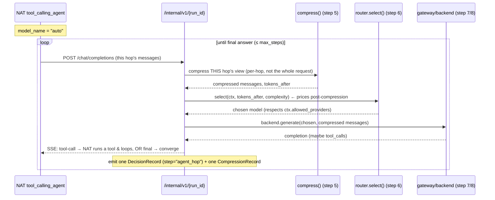

# RouteForge — Sample Request Flows (worked examples)

A companion to [`logical-and-request-flow.md`](./logical-and-request-flow.md)
and the [`diagrams/routeforge-request-flow.drawio`](diagrams/routeforge-request-flow.drawio).

That doc tells you *what* each of the ten steps is. **This doc walks real requests through
them** — three sample apps, each with a real config, so you can mentally trace how a request
moves and where each open-source library actually gets touched. It exists to answer three
questions that the box diagrams don't:

1. How is the **NeMo Agent Toolkit (NAT)** used on the multi-step path?
2. How is the **optional LLM task-mode classifier** used (and why is it "just another routed call")?
3. How do **`app/compression/`, `app/cache/`, `app/memory/`** work *per call*?

> Cost/latency/token numbers below are **illustrative** — they show the shape of a
> `DecisionRecord`, not a benchmark. Everything else (field names, config keys, order of
> operations, defaults) is taken from the code.

---

## 0. The mental model — one spine, two branch points

Every request runs the same spine (steps 1→10). There are only **two** places it branches:

- **Branch point A — step 4, task mode.** `direct` (one model call) vs `multi_step` (hand off
  to the NAT agent runtime, which makes *many* model calls). Decided by
  `app/routing/task_mode.py`.
- **Branch point B — step 5, three optional features.** Semantic cache, persistent memory,
  and compression. **All three ship OFF** (`config/serving.yaml`). When off, they add nothing
  to the request — it passes through byte-for-byte.

### The exact per-call order on the direct path

This is the order in `Pipeline.run()` (`app/pipeline.py`). Memorize this — it's the thing the
diagrams flatten into one "Step 5" box:

| # | Stage | Module | Can it short-circuit? |
|---|-------|--------|------------------------|
| 1 | Authenticate + **sanitize** (PII scan) | `app/policy/gate.py` | Rejects on gate error (fail closed) |
| 2 | Build immutable **policy context** | `app/policy/context.py` | — |
| 3 | Decide **task mode** (direct/multi-step) | `app/routing/task_mode.py` | — |
| 4 | **Memory recall** → *prepend* recalled context | `app/memory/` | No (just adds messages) |
| 5 | **Semantic cache** lookup | `app/cache/` | **Yes** — a verified hit returns immediately, skipping the model call |
| 6 | **Compression** (prices post-compression tokens) | `app/compression/` | No (fails *open*) |
| 7 | **Route + gateway** — pick model, call it | `app/routing/router.py`, `app/gateway/` | — |
| 8 | **Verify** output (leakage, `require_verification`) | `app/output/verify.py` | Rejects on failure |
| 9 | **Memory write** (success path only) | `app/memory/` | — |
| 10 | **Cache store** (on a genuine miss only) | `app/cache/` | — |

Note that **memory recall (4) runs *before* the cache check (5)** on purpose: recalled context
is then priced and compressed like any other tokens. Note also that the **cache is
direct-path only** — the multi-step path skips it (more below).

---

## 1. Three sample apps

An operator registers an app (`POST /admin/applications`), which returns a one-time plaintext
token `rf_live_…`, then sets policy separately (`PUT …/policy`, which **merges** — only the
fields you send change). Per-app policy can only ever *narrow* the global rules, never widen
them; `null` on any field means "inherit / no restriction."

### App A — `internal-chatbot` (low sensitivity, cloud allowed)

```jsonc
// POST /admin/applications
{ "id": "internal-chatbot", "name": "Internal Chatbot",
  "owner_email": "cybelink.webmaster@gmail.com", "default_residency": "any" }

// PUT /admin/applications/internal-chatbot/policy   (merge)
{ "allowed_tiers": ["cheap", "mid"],
  "allowed_providers": ["azure"],
  "max_spend_usd_per_day": 5.0,
  "max_rpm": 120,
  "pii_detection": "regex",
  "capture_io": "off",
  "stream_mode": "verified_then_stream" }
```

> `pii_detection: regex` pairs only with `capture_io: "off"` or `"full"` — not `"redacted"`:
> the `redacted` exporter path reuses the gate's sanitized prompt, and with a downgraded
> detector that "sanitized" text is raw (`app/api/admin_routes.py`, the
> `eff_pii in ("off", "regex")` + `eff_capture == "redacted"` clamp — a 422 on write). See
> [`../guides/getting-started.md`](../guides/getting-started.md)'s identical Internal-chatbot recipe.

### App B — `hospital-phi` (onprem_only, Presidio, high sensitivity)

```jsonc
// POST /admin/applications
{ "id": "hospital-phi", "name": "General Health PHI Assistant",
  "owner_email": "cybelink.webmaster@gmail.com", "default_residency": "onprem_only" }

// PUT /admin/applications/hospital-phi/policy
{ "residency": "onprem_only",
  "allowed_providers": ["onprem"],
  "allowed_tiers": ["mid", "frontier"],
  "max_spend_usd_per_day": 50.0,
  "pii_detection": "presidio",
  "capture_io": "off",
  "stream_mode": "verified_then_stream" }

// PUT /admin/applications/hospital-phi/privacy   (optional: a custom entity + rules)
{ "recognizers": [ { "name": "MRN", "regex": "\\bMRN-\\d{7}\\b", "score": 0.9, "enabled": true } ],
  "rules": [
    { "entities": ["US_SSN", "MEDICAL_LICENSE", "MRN"], "sensitivity": "restricted",
      "risk_class": "high", "residency": "onprem_only", "require_verification": true },
    { "entities": [], "sensitivity": "public",
      "risk_class": "low", "residency": "onprem_only", "require_verification": false } ] }
```

> For an `onprem_only` app in the default `enforced` posture the write-time floors reject
> `capture_io: full` and `stream_mode: stream_unverified` — those guarantees can't be waived
> per-app. `pii_detection: off|regex` **is** permitted at `onprem_only` (detection and
> residency are independent axes), but only alongside `capture_io: "off"`, so there is no
> egress path for an unsanitized prompt. An app that genuinely has nothing to protect
> declares `policy_mode: "passthrough"` instead — which unlocks `capture_io: full` into its
> **own** Langfuse project while leaving `onprem_only` absolute. See
> [`../reference/per-app-config.md`](../reference/per-app-config.md).

### App C — `research-agent` (multi-step, cloud + frontier)

```jsonc
// POST /admin/applications
{ "id": "research-agent", "name": "Research Agent",
  "owner_email": "cybelink.webmaster@gmail.com", "default_residency": "private_cloud_ok" }

// PUT /admin/applications/research-agent/policy
{ "residency": "private_cloud_ok",
  "allowed_tiers": ["mid", "frontier"],
  "allowed_providers": ["azure", "bedrock"],
  "max_spend_usd_per_day": 25.0,
  "max_rpm": 30,
  "compression_enabled": true,
  "pii_detection": "presidio",
  "capture_io": "redacted",
  "stream_mode": "off" }
```

**Vocab recap** (valid values): providers `onprem | azure | bedrock`; tiers `cheap | mid | frontier`;
residency `any | private_cloud_ok | onprem_only`; sensitivity `public | internal | confidential | restricted`;
risk_class `low | medium | high`; `pii_detection` `off | regex | presidio`;
`stream_mode` `off | verified_then_stream | stream_unverified | incremental_verify`.

There is **no `sensitivity` field on an app** — sensitivity is computed *per request* from the
entities the gate detects (see Flow B). And multi-step caps (`max_steps: 5`, etc.) are **global**
in `config/policy.yaml → agent_budgets`, not per-app.

---

## Flow A — a simple question (direct path, everything default-OFF)

**App:** `internal-chatbot`. **Request:**

```http
POST /v1/chat/completions
Authorization: Bearer rf_live_x7Kp…
{ "model": "auto", "messages": [ {"role":"user","content":"What is the capital of France?"} ] }
```

This is the baseline: classifier OFF, cache/memory/compression all OFF. Trace:

| Step | What happens | DecisionRecord fields (illustrative) |
|------|--------------|--------------------------------------|
| 1 · API | `routes.py` receives the call; token → `Application` (+ policy) is resolved fail-closed. | `request_id=req_a1` |
| 2 · Gate | `pii_detection: regex` runs. No entities found. Text unchanged. | `step=policy_gate, entities=[]` |
| 3 · Context | No entity rule matched → the `[]` catch-all → **`sensitivity=public, residency=any, risk=low`**. App narrows providers to `{azure}`, tiers to `{cheap, mid}`. | `allowed_providers=[azure], allowed_tiers=[cheap,mid]` |
| 4 · Task mode | `task_mode.decide()`: last user message has no trigger phrase, `mock_multistep=false` → **`"direct"`**. Classifier OFF → no record. | — |
| 4a · Memory recall | `memory.enabled=false` → bypass `"disabled"`. Nothing added. | (no record) |
| 5a · Cache lookup | `semantic_cache.enabled=false` → skipped entirely. | (no record) |
| 5b · Compression | `context_optimization.enabled=false` → bypass `"disabled"`. Tokens unchanged. | `bypass_reason=disabled` |
| 6 · Route | Router scores the `{azure}` × `{cheap,mid}` candidates on ~8 tokens, `complexity≈0.004` → target tier `cheap`. `azure-gpt-mid` is the only `azure` candidate in the static cloud pool (it is **mid**-tier, not cheap — `config/routing.yaml` has no cheap-tier `azure` entry), so the router escalates and picks it. | `step=route, chosen=azure-gpt-mid, chosen_tier=mid, reason="tier mid (target cheap)", est_cost=$0.0000xx` |
| 7 · Gateway | LiteLLM calls Azure. Returns "Paris." | `actual_cost=$0.0000xx, latency_ms=180, tokens_out=3` |
| 8 · Verify | Leakage checks pass; `require_verification=false`. | `step=verify, ok=true` |
| 9 · Memory write | `memory.enabled=false` → skipped. | — |
| 10 · Response | Assemble governed response + full trace. Return `200`. Because `capture_io=off`, Langfuse gets the decision trace **with no I/O** — no raw prompt, no completion. | — |

**Takeaway:** with the three step-5 features off, "Step 5" is a no-op and the request is
essentially *gate → route → verify*. This is the default posture.

---

## Flow A′ — the SAME app with step-5 features turned ON

Now the operator flips the three flags (in `serving.yaml`, or live per-app for compression via
`POST /api/controls`):

```yaml
# config/serving.yaml
context_optimization: { enabled: true, mode: library, min_tokens: 2000, ccr: { enabled: true } }
memory:               { enabled: true, max_recall: 3, ttl_hours: 24 }
semantic_cache:       { enabled: true, ttl_hours: 24 }
```

This is the section to read if `app/compression`, `app/cache`, `app/memory` are the confusing
part. Watch three requests in one session (`x-routeforge-session: sess-42`).

### Request ①  — "Summarize this 6-page incident report: …" (first time, ~3,000 tokens)

| Stage | What the module does |
|-------|----------------------|
| **Memory recall** (`app/memory/`) | Partition key = `(tenant, application_id, session_id)`. Session `sess-42` is new → nothing to recall. |
| **Cache lookup** (`app/cache/`) | Key = the *normalized query string* (lowercase, whitespace-collapsed). Partition = `(tenant, onprem_only, allowed_providers)`. **Miss** — first time. |
| **Compression** (`app/compression/`) | `tokens_before=3000 ≥ min_tokens (2000)` and not high-risk/restricted → **runs**. `select_compressor()` sees `mode: library`, tries `HeadroomCompressor` (`from headroom import compress`). If the `[compression]` extra isn't installed, it silently falls back to the in-house `DeterministicCompressor` (collapse blank lines, dedupe repeated lines). Result: `tokens_after=2100`. The **last user message is protected** (never compressed) so the live question stays verbatim. Because `ccr.enabled=true`, the *original* pre-compression text is stashed in the **CCRStore** — a local, TTL-bounded cache of originals that **never leaves the residency boundary and is never exported to telemetry**. |
| **Route** | The router prices **`tokens_after=2100`, not 3000** — this is the whole point of running compression *before* the router. `compression_saved_usd` is booked from the 900-token drop. |
| **Gateway → Verify → Respond** | Normal. |
| **Memory write** | On success, stores a bounded summary `"user: <sanitized>\nassistant: <verified output>"` (truncated to 2000 chars) under `sess-42`. **Sanitized input + post-verify output only — never raw text.** |
| **Cache store** | On this genuine miss, stores the verified response under the normalized-query key. |

### Request ②  — the *exact same* summarize request again

| Stage | What happens |
|-------|--------------|
| Memory recall | Recalls request ①'s summary, prepends it as a `user` message. |
| **Cache lookup** | **HIT.** The normalized query matches. The cached response is **re-verified against the *current* request's detector/context** (a cached answer can't leak for the new caller). Re-verify passes → **the pipeline returns immediately** (`return hit_resp`): **no compression, no model call, no gateway.** `cache_saved_usd` = the full all-frontier baseline; routing/compression savings = 0. |

That short-circuit is why the cache sits *before* compression and the model call. A cache
hit is the cheapest possible outcome.

### Request ③  — a *follow-up* in the same session: "Now list just the action items."

| Stage | What happens |
|-------|--------------|
| **Memory recall** | Different query, so **cache misses** — but memory **recalls** the earlier summary for `sess-42` and prepends it, giving the model continuity ("the report" refers to request ①). This is what "persistent memory, per call" means: short-term, session-scoped, in-process, TTL-bounded recall — **not** mem0, not a vector DB. |
| Cache lookup | Miss (new query). |
| Compression | Runs on the combined (recalled + new) messages. |
| Route → … | Normal, then writes request ③ back into memory. |

**Three honesty rules to remember about step 5:**
- **Cache** keys on a *normalized string*, not embeddings — it's exact-match, and it
  **re-verifies every hit**. It's residency-partitioned: an `onprem_only` lookup can never
  return a cloud-produced entry.
- **Memory** stores only sanitized/verified summaries, always `to_cloud=False`, TTL-evicted.
- **Compression** fails *open* (on error, returns uncompressed text) — it must never block a
  request. CCR (the cache of originals) fails *closed* on residency: for `onprem_only`,
  originals never travel to cloud.

All three **bypass automatically** on `high_risk` or `restricted` sensitivity (configurable in
`bypass_on`), so the hospital persona below never puts sensitive originals in a cache.

---

## Flow B — a request with an SSN (privacy gate in action)

**App:** `hospital-phi`. **Request:** `"Does patient with SSN 123-45-6789 qualify for the trial?"`

> The `presidio` extra is not installed in the venv this doc was last verified from, so the
> "no healthy on-prem model → 422" mechanism below (rows 3-4) was executed with `pii_detection:
> "regex"` standing in for `"presidio"` — the mechanism under test
> (`ModelRegistry.has_healthy_onprem()` dropping `onprem` from `allowed_providers`) is
> detector-independent, and `regex` also matches `US_SSN` (`app/policy/detectors.py`). Presidio
> actually detecting `US_SSN` (row 2) is stable, well-tested third-party behavior and was not
> re-executed here.

| Step | What happens |
|------|--------------|
| 2 · Gate | `pii_detection: presidio` (Presidio + spaCy NER) detects **`US_SSN`**. The gate **redacts** it before anything downstream sees the text: `"… SSN <US_SSN> …"`. (Nothing external has seen the raw request — rule #1.) |
| 3 · Context | The detected entity `US_SSN` matches the first sensitivity rule → **`sensitivity=restricted, risk_class=high, residency=onprem_only, require_verification=true`**. The app's own residency is already `onprem_only`; `_stricter()` keeps the stricter of the two. **`onprem_only` ⇒ `allowed_providers = enabled ∩ {onprem}`** — Azure/Bedrock are *filtered out of the candidate pool now*, before the router scores anything (rule #3). |
| — | *If no healthy on-prem model is onboarded*, `has_healthy_onprem()` is false → `onprem` is dropped too → **empty candidate set → request rejected (422)**. This is the privacy guarantee: never silently fall through to cloud. |
| 4 · Task mode | No trigger phrase → `direct`. |
| 5 · Step-5 | `risk_class=high` → compression, cache, and memory **all bypass** (`bypass_on.high_risk`). Sensitive originals never enter any cache. |
| 6 · Route | Only on-prem candidates remain. `risk=high` + `onprem_only` floors to the best **allowed (on-prem)** tier — it is **never lifted to cloud** to satisfy the floor (rule #8). Picks an onboarded on-prem model, e.g. `onprem-llama-mid`. |
| 7 · Gateway | LiteLLM calls the on-prem endpoint. |
| 8 · Verify | `require_verification=true` → the stricter output check runs; leakage checks confirm no PII in the completion. |
| 10 · Response | `200`. Because `capture_io=off`, Langfuse gets the decision trace **with no I/O** — no raw prompt, no completion, no CCR contents. |

**Takeaway:** privacy is *structural*. The cloud providers are removed from the pool at step 3,
so no later bug can route this to Azure. Sensitivity is derived from detected entities, not
declared by the app.

---

## Flow C — a multi-step task (how NeMo Agent Toolkit is used)

**App:** `research-agent`. **Request:**

```json
{ "model": "auto", "messages": [
  {"role":"user","content":"Look up Acme's latest revenue and draft a one-paragraph summary."} ]}
```

### Why it goes multi-step
`task_mode.decide()` finds the trigger phrase **`"look up"`** in the last user message → returns
`"multi_step"`. (The other triggers are `"step by step"` and the demo-only `mock_multistep: true`.)
The pipeline calls `_run_multi_step(...)`, which hands off to `agent_run(...)` in
`app/agent/runtime.py`.

### What NAT actually does
NAT (`nvidia-nat`, the `agent` extra) is **lazy-imported only here** — the direct path never
imports it. The runtime:

1. `load_config("config/nat_workflow.yaml")` — a `tool_calling_agent` workflow with **one LLM
   named `sp_router` (`model_name: auto`)** and three tools: `calculator`, `doc_search`,
   `crm_lookup` (registered in the `nat_tools` package). **These are RouteForge's own
   built-in demo tools, not `research-agent`'s (or any app's) real tools** — `doc_search`
   and `crm_lookup` are docstring-labelled `FAKE` and return a canned string with no real
   call (`nat_tools/src/nat_tools/tools.py:72,110`); only `calculator` computes anything.
   They exist to demonstrate the per-hop routing mechanism below, not to perform real work.
   The supported path for an application's *real* tools is the client-driven loop —
   RouteForge never executes an app's own tools itself (`tools`/`tool_choice` on
   `/v1/chat/completions` come back as `tool_calls` for the *client* to run and replay; see
   [`../reference/api-reference.md`](../reference/api-reference.md)).
2. **Repoints that LLM at RouteForge itself:** `base_url =
   http://127.0.0.1:{port}/internal/v1/{run_id}`. This is the trick — the agent thinks it's
   calling one OpenAI endpoint named "auto", but every call loops back **into RouteForge's own
   router**.
3. Sets `max_iterations` from `config/policy.yaml → agent_budgets.max_steps` (5).
4. Runs the agent loop until it produces a final (non-tool-call) answer.

### The hop loop — each hop is a full routed + compressed call



So for a 3-hop task you get **3 independent** `compress()` + `router.select()` +
`backend.generate()` cycles — not one big call. That's the single most important thing to see:
**compression and routing are per-call (per-hop), not per-request.** A typical trace:

| Hop | Agent's intent | Compressed tokens | Model chosen (tier) | Cost |
|-----|----------------|-------------------|---------------------|------|
| 1 | "I need Acme's revenue → call `crm_lookup`" | 120 | `azure-gpt-mid` (mid) | $0.0003 |
| 2 | Reason over the tool result → call `doc_search` | 340 (compressed from 900) | `azure-gpt-mid` (mid) | $0.0006 |
| 3 | Draft the summary paragraph | 500 | `bedrock-frontier` (frontier) | $0.004 |

- The **same `ExecutionPolicyContext`** rides every hop, so residency (`onprem_only`) and
  `allowed_providers` hold on hop 3 exactly as on hop 1 — the agent can't escape policy
  mid-task.
- Each hop appends its own `DecisionRecord(step="agent_hop")` with **real** per-hop cost and
  latency, plus a 1:1 `CompressionRecord`. The pipeline **sums cost across hops** and reports
  routing-savings vs compression-savings separately.
- **Cap / fail-closed:** if the agent can't converge within `max_steps`, the runtime raises
  `AgentCapExceeded` → HTTP 500 "agent did not converge within its step limit." It never
  loops forever and never returns a half-answer as success.
- **Cache is skipped on the multi-step path**; memory recall still runs once up front, and
  compression runs *per hop*.
- **Telemetry:** NAT's own Langfuse exporter is deliberately left **off** — it would emit raw
  per-hop I/O and bypass RouteForge's egress redaction. Redacted per-hop spans go through
  RouteForge's own exporter instead (rule #2).

### After the loop
The final answer runs through **step 9 verification** once (leakage checks), then the pipeline
assembles the governed response: summed cost, two-lever savings, and a `trace` = per-hop
decision records + per-hop compression records + the verify record.

---

## The optional LLM task-mode classifier (branch point A, upgraded)

By default, step 4 is the **rules-first** `task_mode.decide()` — a substring match on the last
user message. An operator can instead turn on an **LLM classifier** to make the direct/multi-step
call. This is off in two independent ways by default, and *both* must be flipped to enable it:

```yaml
# config/routing.yaml   (no prompt_opt block ships → all defaults → OFF)
routing:
  prompt_opt:
    enabled: true                       # (1) master switch, default false
    active: { task_mode_classifier: v1 }  # (2) pin a human-verified prompt artifact
```

When on, `classify_task_mode()` runs — and the load-bearing design point is that **it is just
another routed call**:

- It never builds its own backend or provider client. Its *only* path to a model is
  `router.select(ctx, …)` — the identical seam every other call uses.
- Because `router.select()` **drops every candidate whose provider ∉ `ctx.allowed_providers`
  before scoring**, the classifier **cannot break `onprem_only`** — under that residency it can
  only pick an on-prem model or raise `NoEligibleCandidate`.
- Its input is the **already-sanitized** text (the raw request is never sent). Its prompt is a
  pinned, human-verified artifact (`config/prompts/task_mode_classifier/v1.yaml`) that says
  *"Answer with exactly one word: 'direct' or 'multi_step'."*
- It **emits its own `DecisionRecord`** (`step="task_mode_classifier"`) whose cost is folded
  into the request total — so the classifier's cost is never invisible.
- **Fail-closed:** on *any* trouble (no eligible candidate, backend error, unparseable answer)
  it falls back to the deterministic `decide()` result and records why. A classifier failure
  degrades to the safe rules default — never a crash or a residency bypass.

So the classifier changes *how* the direct/multi-step decision is made, but it obeys every
rule the rest of the pipeline does. That's why it can be swapped in without weakening any
guarantee.

---

## Recap — which libraries each flow touches

| | Flow A (default) | Flow A′ (step-5 on) | Flow B (SSN) | Flow C (multi-step) |
|---|---|---|---|---|
| Gate | `regex` | `regex` | **Presidio + spaCy** | Presidio |
| Task mode | rules | rules | rules | rules → **`"look up"`** |
| Memory (`app/memory`) | off | **recall+write** | bypass (high-risk) | recall once |
| Cache (`app/cache`) | off | **hit/miss** | bypass (high-risk) | **skipped (multi-step)** |
| Compression (`app/compression`) | off | **Headroom/deterministic + CCR** | bypass (high-risk) | **per-hop** |
| Agent runtime | — | — | — | **NeMo Agent Toolkit** |
| Router + gateway | LiteLLM → Azure | LiteLLM → Azure | LiteLLM → **on-prem only** | LiteLLM, per hop |
| Verify | basic | basic | **`require_verification`** | once, after loop |
| Langfuse capture | off (no I/O) | off (no I/O) | **off (no I/O)** | redacted per-hop |

Every row of every flow emits a `DecisionRecord`. The "why" in those records — which
candidates were rejected and why — is the product.

---

## See also

- [`logical-and-request-flow.md`](./logical-and-request-flow.md) — the ten steps and their libraries, with status markers.
- [`../reference/per-app-config.md`](../reference/per-app-config.md) — the `pii_detection` / `stream_mode` knobs and their write-time floors.
- [`../guides/onboarding-models.md`](../guides/onboarding-models.md) — how the on-prem pool is populated at runtime (Flow B needs a healthy on-prem model).
- [`../reference/routing-observability.md`](../reference/routing-observability.md) — `sp.candidates`, stage signals, `/metrics`.
