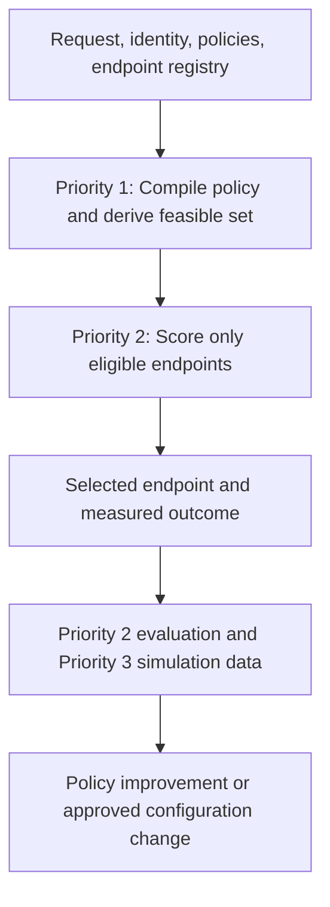

# RouteForge AI: Priorities 1–3 Consolidated Technical Hand-off

**Document purpose:** Consolidate the proposed designs, examples, customer value, implementation boundaries, and IP/research positioning for the first three RouteForge feature priorities.

**Intended use:** This document is structured as context for another LLM, engineer, product architect, researcher, or IP reviewer.

**Status:** Proposed design. Do not assume these capabilities are already implemented. Confirm the current repository, policy schema, endpoint registry, telemetry, and customer requirements before producing implementation code or patent language.

**Important limitation:** All companies, workloads, volumes, prices, quality scores, latency values, and savings figures in the examples are illustrative.

---

## 1. RouteForge product boundary

RouteForge is a routing and governance layer placed between an AI application and externally managed model endpoints. Endpoints may include customer-hosted vLLM or NVIDIA Dynamo services, managed cloud models, or other OpenAI-compatible APIs.

RouteForge may:

- inspect and classify incoming requests;
- combine application, tenant, user, request, and endpoint policies;
- remove ineligible endpoints before scoring;
- select among eligible endpoints using cost, quality, latency, availability, and related signals;
- enforce compliant retries and fallbacks;
- record routing decisions and outcomes;
- evaluate routing strategies offline; and
- simulate the effect of proposed policy, endpoint, and pricing changes.

RouteForge does **not**:

- host or train foundation models;
- schedule GPUs or replace Run:ai, Kubernetes, vLLM, or NVIDIA Dynamo;
- deploy models as part of the routing decision;
- automatically relax residency or protection policies; or
- prove that a provider's contractual claims are true.

Its guarantees are limited to RouteForge's own policy semantics, routing behavior, recorded endpoint declarations, and observed telemetry.

---

## 2. Executive summary of the three priorities

| Priority | Capability | Primary question answered | Main customer outcome |
|---|---|---|---|
| **1** | Constraint-Isolated Policy Compiler and Noninterference Proof Harness | **Which endpoints are allowed for this request, and can RouteForge prove that the policy behaved safely?** | Prevents one policy setting from silently changing another, excludes noncompliant endpoints before scoring, and produces testable decision evidence. |
| **2** | Feasible-Set Router Learning and Evaluation Plane | **Among the endpoints allowed for this request, which one should RouteForge use?** | Improves cost, quality, and latency only within the customer's permitted choices and measures results against a realistic feasible oracle. |
| **3** | Traffic-Weighted Policy Counterfactual Simulator | **What will happen to the customer's overall workload if a policy, endpoint, price, or capability changes?** | Predicts cost, latency, capacity, availability, quality, and rejection impact before a change reaches production. |

The priorities form a dependency chain:



The governing principle is:

> **Deterministic policy decides what is permitted. Optimization operates only inside that permitted set.**

---

# Priority 1: Constraint-Isolated Policy Compiler and Noninterference Proof Harness

## 3. Purpose

Priority 1 is a safety compiler for routing policies. It combines all relevant policy inputs into a deterministic, versioned decision while keeping independent policy dimensions separate.

It prevents situations such as:

- selecting stronger data protection and unintentionally changing data residency;
- changing residency and accidentally weakening retention or redaction requirements;
- allowing an endpoint with missing compliance metadata;
- falling back to an endpoint excluded by the original policy; or
- tightening a rule and unexpectedly increasing the number of eligible endpoints.

## 4. Meaning of the terms

### Constraint-isolated

Different controls remain in separate typed policy axes. The two most important initial axes are:

- **Placement:** Where processing is allowed, such as `ANYWHERE`, `US_ONLY`, or `ONPREM_ONLY`.
- **Protection:** How the data must be handled, such as redaction, encryption, zero retention, or raw-PII restrictions.

Other axes can later include retention, contractual provider allowlists, model capability, user entitlement, or workload risk. An axis must not silently rewrite another axis.

### Policy compiler

The compiler combines:

- application policy;
- tenant or department policy;
- user identity and role;
- request-specific declarations;
- detected risk signals;
- endpoint metadata; and
- current policy and registry versions.

It produces effective typed constraints and a request-specific eligible endpoint set before optimization begins.

### Noninterference

Changing one policy axis must not implicitly mutate another. For example, changing protection from `STANDARD` to `CONFIDENTIAL` must not rewrite placement from `US_ONLY` to `ONPREM_ONLY` unless an authorized administrator defined an explicit cross-axis rule.

Stronger protection may remove endpoints that cannot meet the requirement, so the selected endpoint may change. However, the protection signal must not secretly rewrite the declared placement policy.

### Proof harness

The proof harness is an automated testing system that attempts to violate the policy invariants. When it finds a problem, it produces a concrete counterexample showing the exact policies, endpoint facts, and request conditions that caused the unsafe result.

This is a machine-checkable proof of RouteForge policy behavior, not proof that a cloud provider is honoring its contract.

## 5. Required invariants

1. Tightening a constraint cannot enlarge the eligible endpoint set.
2. Changing protection cannot rewrite placement unless a separately authorized cross-axis rule permits it.
3. Changing placement cannot weaken protection.
4. Missing or unknown endpoint metadata fails closed.
5. An empty feasible set results in explicit rejection, not automatic policy relaxation.
6. Retry and fallback endpoints must remain inside the original or a more restrictive feasible set.
7. Every decision must identify the effective policy and endpoint-registry versions.

## 6. Healthcare example

A health insurer connects RouteForge to four endpoints:

| Endpoint | Location | Data handling | Relative cost |
|---|---|---|---:|
| Local Llama | Customer data center | Raw patient data permitted | Medium |
| Azure US model | United States | Permitted after PII redaction; no retention | Low |
| European model | Germany | Strong privacy controls | Lowest |
| General US model | United States | Retains prompts for 30 days | Low |

The customer defines:

```text
Placement:
    Patient data must remain in the United States.

Protection:
    Direct identifiers must be removed before external processing.
    The provider must not retain prompts.
```

A claims employee submits a request containing a patient name, Social Security number, and diagnosis.

The compiler combines the application policy, claims-department policy, user role, detected PII, and endpoint declarations. It derives:

```text
Effective placement:
    US_ONLY

Effective protection:
    CONFIDENTIAL
    REDACT_DIRECT_IDENTIFIERS
    NO_PROMPT_RETENTION
```

The eligible-set result is:

| Endpoint | Result | Reason |
|---|---|---|
| Local Llama | Eligible | On-premises US endpoint that supports restricted data |
| Azure US model | Eligible after redaction | US endpoint with approved no-retention handling |
| European model | Excluded | Violates `US_ONLY` placement |
| General US model | Excluded | Violates the no-retention requirement |

Only Local Llama and Azure US reach the RouteForge scoring logic.

## 7. Misconfiguration this feature prevents

Assume an administrator creates hidden behavior like this:

```text
policy_mode = confidential
    automatically changes
residency = onprem_only
```

The compiler should reject it because a protection value is implicitly rewriting placement:

```text
Compilation failed.

Protection rule "confidential" attempted to modify placement
from US_ONLY to ONPREM_ONLY.

Declare and authorize an explicit cross-axis rule if this
behavior is required.
```

This matters because a customer may legitimately want `US_ONLY` placement with confidential handling, which still permits an approved US cloud provider after redaction. Customers should not have to misuse residency to receive stronger data protection.

## 8. Example decision certificate

```json
{
  "request_id": "rf-94821",
  "placement": {
    "value": "US_ONLY",
    "sources": ["claims-app-policy-v42"]
  },
  "protection": {
    "value": "CONFIDENTIAL",
    "sources": [
      "claims-department-policy-v9",
      "pii-detector:ssn",
      "health-data-detector"
    ]
  },
  "eligible_endpoints": [
    "local-llama",
    "azure-us-no-retention"
  ],
  "excluded_endpoints": {
    "eu-model": "region_not_allowed",
    "general-us-model": "prompt_retention_not_allowed"
  },
  "allowed_fallbacks": ["local-llama"],
  "checks": {
    "candidate_set_monotonicity": "passed",
    "axis_noninterference": "passed",
    "fallback_compliance": "passed"
  },
  "policy_version": 42,
  "endpoint_registry_version": 117
}
```

## 9. Customer value

Priority 1 allows a customer to answer:

> “If we strengthen PII protection, could RouteForge accidentally move processing outside the United States or weaken another control?”

The response is backed by generated tests, exclusion reasons, policy versions, and request-level certificates rather than documentation alone.

## 10. Proposed implementation components

- Typed policy intermediate representation
- Independently declared placement and protection types
- Monotone meet operations for constraint aggregation
- Explicitly authorized cross-axis rules
- Endpoint-registry schema and completeness validation
- Fail-closed eligible-set builder
- Policy linter that generates counterexamples
- Property-based and mutation tests
- Versioned decision-certificate serialization
- Retry and fallback invariant verification
- Operator-facing explanations

## 11. IP and research position

Generic privacy-aware filtering and declarative routing policies are already crowded. The narrower candidate is the integrated RouteForge mechanism combining independently typed axes, explicit cross-axis authorization, machine-checked noninterference, candidate-set monotonicity, counterexample generation, and fallback preservation in a pure LLM router.

The abstract mathematics should not be treated as the invention. The potentially protectable contribution is the concrete routing mechanism and the measurable failures it prevents.

---

# Priority 2: Feasible-Set Router Learning and Evaluation Plane

## 12. Purpose

Priority 2 makes the request-specific feasible set a first-class input to routing, learning, and evaluation.

It ensures that RouteForge:

- scores only endpoints permitted for the current request;
- normalizes selection probabilities only across eligible endpoints;
- explores alternatives only inside the permitted set;
- explicitly rejects empty feasible sets;
- learns which eligible endpoint is best for each workload; and
- measures performance against the best feasible endpoint rather than an impossible global endpoint.

Priority 2 does not train the foundation models. It improves the smaller routing model, scoring rules, or calibration used to select among existing endpoints.

## 13. Runtime design

```python
feasible_set = policy_compiler.get_eligible_endpoints(
    request=request,
    identity=identity,
    policy=policy,
    endpoint_registry=registry,
)

if not feasible_set.endpoints:
    return reject(feasible_set.exclusion_reasons)

scores = router.score(
    request=request,
    candidate_endpoints=feasible_set.endpoints,
)

selected = select_best(scores)
```

An ineligible endpoint must be masked before probability normalization or ranking. It must not be ranked first and removed afterward.

## 14. Healthcare example

Illustrative endpoint performance:

| Endpoint | Quality | Cost/request | Latency | Eligibility issue |
|---|---:|---:|---:|---|
| Local Llama | 92 | $0.08 | 900 ms | None for raw patient data |
| Azure US model | 89 | $0.03 | 600 ms | Requires redaction and no retention |
| European model | 94 | $0.02 | 500 ms | Ineligible for US-only workloads |
| General US model | 91 | $0.025 | 550 ms | Retains prompts |

Globally, the European model appears best. For the PII-containing claim request, Priority 1 produces:

```text
E(request) = {
    Local Llama,
    Azure US model after redaction
}
```

If the customer requires quality of at least 88, Priority 2 may select Azure US at $0.03 instead of Local Llama at $0.08. That is a 62.5% illustrative saving among endpoints the customer is actually allowed to use.

The router must not be judged against the cheaper European model because that model is not a legal choice for this request.

## 15. Request-specific feasible sets

Different requests produce different permitted choices:

| Request type | Illustrative feasible set | Expected behavior |
|---|---|---|
| Public benefits FAQ | Local Llama, Azure US, General US | Select based on cost, quality, and latency |
| Patient claim with direct PII | Local Llama, Azure US after redaction | Exclude retention and non-US endpoints |
| Contract requires on-premises processing | Local Llama only | No routing optimization is needed |
| On-premises required but Local Llama is unavailable | Empty | Reject with exact reasons; do not relax policy |

## 16. Learning behavior

For completed requests, RouteForge records policy-safe outcome data:

```json
{
  "task": "claim_summary",
  "policy_version": 42,
  "registry_version": 117,
  "eligible_endpoints": [
    "local-llama",
    "azure-us-no-retention"
  ],
  "selected_endpoint": "azure-us-no-retention",
  "quality_score": 0.91,
  "cost": 0.03,
  "latency_ms": 610,
  "policy_violation": false
}
```

Over time, the improvement plane may learn that:

- Azure US is sufficient for short, redacted claim summaries;
- Local Llama performs better for long clinical documents;
- redaction sometimes removes context needed for specific tasks;
- an endpoint becomes slower at particular times; or
- certain document classes require a higher-quality endpoint.

Any online exploration is restricted to the feasible set. RouteForge must never send protected traffic to an ineligible endpoint merely to collect training data.

## 17. Feasible-oracle evaluation

A global benchmark asks:

> “Did the router choose the best model from every model in the registry?”

That is misleading when some models are unavailable for policy reasons.

A feasible benchmark asks:

> “Did the router choose the best endpoint it was legally, technically, and operationally allowed to use for this specific request?”

The best permitted choice, using known outcomes, is the **feasible oracle**.

## 18. Required evaluation metrics

1. **Policy-violation rate:** Must be zero for deterministic constraints.
2. **Feasible-oracle quality regret:** Quality lost relative to the best eligible endpoint.
3. **Feasible-oracle cost regret:** Excess cost relative to the cheapest eligible endpoint meeting the quality floor.
4. **Latency regret:** Additional latency relative to the best feasible option.
5. **Correct empty-set handling:** Whether RouteForge rejected when no compliant endpoint existed.
6. **Calibration:** Whether routing confidence corresponds to observed success.
7. **Policy-churn robustness:** Behavior when policies or endpoint declarations change.
8. **Endpoint-churn robustness:** Behavior when endpoints are added, removed, repriced, or become unhealthy.
9. **Worst-group performance:** Results by placement class, protection class, tenant, and workload type.
10. **Noninterference failure rate:** Failures discovered under generated policy mutations.

## 19. Evaluation plane

The offline evaluation plane should replay historical or synthetic requests using the policy and endpoint-registry versions that applied at the selected time.

It should compare:

- cheapest feasible endpoint;
- highest-quality feasible endpoint;
- fixed-endpoint routing;
- the current RouteForge router;
- alternative router versions; and
- the feasible oracle.

Training and heavy evaluation may run outside the RouteForge serving process. RouteForge remains a thin runtime router while Langfuse, NeMo Agent Toolkit, or another evaluation system can provide traces and quality signals.

## 20. Customer value

Priority 2 supports a credible claim such as:

> “RouteForge reduced model cost by 24% at the same quality level, measured only among endpoints permitted by your residency, privacy, retention, security, and availability requirements.”

This is more meaningful than comparing RouteForge against a cheap model the customer could never use.

## 21. IP and research position

Policy filtering and constrained selection are known ideas. The narrower integrated IP candidate combines a versioned request-specific feasible set with pre-normalization masking, feasible-set-bounded learning and exploration, explicit empty-set rejection, fallback preservation, and feasible-oracle evaluation.

This priority is particularly strong as a research and dataset opportunity. A proposed paper and benchmark is:

> **FeasibleRouteBench: Evaluating LLM Routers Under Request-Specific Eligibility Constraints**

The benchmark should introduce policy and registry versions, changing feasible sets, empty-set cases, endpoint churn, policy churn, safe exploration, and feasible-oracle regret.

---

# Priority 3: Traffic-Weighted Policy Counterfactual Simulator

## 22. Purpose

Priority 3 predicts the workload-wide effect of a proposed policy, endpoint-registry, capability, health, or pricing change before it reaches production.

It answers:

- How many requests will change routes?
- How much will cost increase or decrease?
- Will quality or latency change?
- Will on-premises GPU capacity be sufficient?
- How many requests may be rejected?
- Which tenants and applications are affected?
- Which constraint causes the largest business effect?
- Which small group of conflicting requirements makes the feasible set empty?

The simulator does not enable the proposed configuration. It creates a change-impact report for authorized review.

## 23. Meaning of the terms

### Traffic-weighted

Results reflect the customer's actual or representative request distribution. A workload representing 60% of traffic contributes more to cost and capacity estimates than one representing 0.5%.

Traffic weighting is used for business forecasting. It never weakens a security rule for a low-volume request.

### Counterfactual

The simulator asks:

> “What would have happened if the proposed policy, registry, price, or endpoint state had been active for this historical workload?”

### Simulator

The simulator replays privacy-preserving routing records against versioned proposed configurations. It recalculates the feasible set, predicts the route, and aggregates estimated cost, quality, latency, availability, capacity, cache, and rejection effects.

## 24. Privacy-preserving replay record

Raw customer prompts should not be required when derived routing features are sufficient.

```json
{
  "task_type": "claim_summary",
  "sensitivity": "health_data",
  "contains_direct_pii": true,
  "tokens_after_redaction": 4200,
  "policy_version": 42,
  "registry_version": 117,
  "current_eligible_endpoints": [
    "local-llama",
    "azure-us-no-retention"
  ],
  "selected_endpoint": "azure-us-no-retention",
  "cost": 0.03,
  "latency_ms": 620,
  "quality_score": 0.91,
  "request_count_weight": 1840
}
```

`request_count_weight` means the record represents 1,840 similar requests in the selected period.

## 25. Healthcare example

The insurer processes 10 million monthly requests:

| Workload | Monthly traffic | Share |
|---|---:|---:|
| Public benefits questions | 6,000,000 | 60% |
| Redacted claim summaries | 2,500,000 | 25% |
| Claims containing raw patient data | 1,000,000 | 10% |
| Legal and audit requests | 500,000 | 5% |

Current policy:

```text
Public questions:
    US cloud or on-premises allowed

Redacted claims:
    US_ONLY
    NO_PROVIDER_RETENTION

Raw patient data:
    ONPREM_ONLY

Legal and audit requests:
    US_ONLY
    NO_PROVIDER_RETENTION
```

The security team proposes:

```text
All healthcare-related requests must use on-premises endpoints.
```

The simulator replays the workload, recalculates every request's feasible set, predicts the route, and aggregates the impact.

An illustrative result could be:

| Metric | Current policy | Proposed policy | Expected change |
|---|---:|---:|---:|
| Monthly inference cost | $290,000 | $610,000 | +$320,000 |
| P95 latency | 800 ms | 1,650 ms | +850 ms |
| Required on-premises utilization | 55% | 230% | Existing capacity is insufficient |
| Rejected requests | 0.1% | 14% | +13.9 percentage points |
| Cloud traffic | 80% | 0% | Completely removed |
| Policy violations | 0 | 0 | No change |

The policy is stricter, but the current on-premises infrastructure cannot support it. RouteForge identifies the problem before deployment.

## 26. Why traffic weighting matters

A four-request test suite containing one example per workload treats each workload as 25% of activity. It may show that all four examples route successfully.

Actual traffic is different. Public questions represent 60% of requests. Moving them from inexpensive cloud endpoints to Local Llama may consume most of the on-premises capacity. Traffic weighting exposes this workload-wide consequence.

## 27. Constraint shadow price

The simulator should estimate the marginal business effect of each requirement. This is the constraint's **shadow price**.

Illustrative output:

| Constraint | Additional monthly cost | Requests affected | Operational effect |
|---|---:|---:|---|
| `US_ONLY` | $35,000 | 1.2 million | European endpoint removed |
| `NO_PROVIDER_RETENTION` | $42,000 | 3 million | Prompt-retaining US endpoint removed |
| Raw PII must remain on-premises | $70,000 | 1 million | Local capacity required |
| All healthcare traffic on-premises | $320,000 | 8.5 million | Capacity exceeded |

The shadow price does not mean a security requirement is wrong. It quantifies the cost, latency, capacity, and rejection implications so security, infrastructure, finance, and application owners can make an informed decision.

## 28. Alternative scenarios

The simulator may compare only administrator-approved alternatives:

| Scenario | Illustrative impact |
|---|---|
| All healthcare traffic on-premises | +$320,000/month; 14% rejection; additional capacity required |
| Only raw PII on-premises; redacted claims use approved US no-retention cloud | +$65,000/month; 0.3% rejection; current capacity sufficient |
| Keep all-healthcare on-premises and expand GPU capacity | +$280,000/month plus infrastructure investment; 0.2% rejection |

RouteForge must never choose an alternative or relax a policy automatically.

## 29. Minimal conflicting policy core

Assume a policy requires:

```text
ONPREM_ONLY
VISION_REQUIRED
CONTEXT_LENGTH >= 200000
RAW_HEALTH_DATA_ALLOWED
```

The only on-premises endpoint supports neither vision nor a 200,000-token context. The feasible set is empty.

Instead of reporting only `No model available`, RouteForge identifies the smallest conflicting requirement set:

```text
No registered endpoint satisfies all of:

- ONPREM_ONLY
- VISION_REQUIRED
- CONTEXT_LENGTH >= 200000
```

It may present authorized remediation options:

1. Deploy an on-premises vision endpoint with the required context.
2. Approve a specific US no-retention cloud vision endpoint.
3. Reduce context through retrieval, summarization, or document segmentation.
4. Remove the vision requirement if the workflow does not need images.

The operator, not RouteForge, chooses whether any remediation is acceptable.

## 30. Other changes the simulator should test

- Adding or removing an endpoint
- Provider price changes
- Region or retention metadata changes
- Context-window or capability changes
- Rate-limit changes
- Endpoint-health degradation
- Loss of a fallback endpoint
- Switching an endpoint between vLLM and NVIDIA Dynamo
- Changes to post-redaction token count
- Changes to prompt-cache affinity and cached-token pricing

## 31. Example change-impact report

```text
Proposed change:
All health-data requests must use on-premises endpoints.

Traffic analyzed:
10,000,000 monthly requests
30 days of versioned production routing patterns

Expected impact:
- 8.5 million requests change routes
- Monthly cost increases by $320,000
- P95 latency increases by 850 ms
- On-premises demand reaches 230% of current capacity
- 14% of requests may be rejected
- No policy violations are expected

Primary cause:
The proposed rule applies on-premises placement to redacted
and low-risk workloads currently served by approved US providers.

Lower-impact alternative:
Apply on-premises placement only to requests containing raw PII.

Alternative impact:
- Monthly cost increases by $65,000
- Existing GPU capacity remains sufficient
- Expected rejection rate is 0.3%
```

## 32. Customer value

Different stakeholders can evaluate the same proposed change:

- **Security:** Does the policy close the intended risk?
- **Compliance:** Which data flows and providers change?
- **Finance:** What is the expected cost impact?
- **Infrastructure:** Is sufficient GPU and endpoint capacity available?
- **Application owner:** Will quality, latency, or availability degrade?
- **Operations:** What happens during endpoint failure or rate limiting?

Priority 3 turns a policy change from a configuration guess into an inspectable change-management process.

## 33. IP and research position

Generic policy previews and workload evaluations are known. The narrower candidate combines traffic-weighted replay, request-specific feasible-set recomputation, versioned policies and registries, multi-objective impact forecasting, constraint shadow prices, minimal conflicting cores, fail-closed behavior, and administrator-controlled remediation.

This is more likely to support dependent claims within the Priority 1 family than a broad standalone patent.

A research paper could compare static policy testing with traffic-weighted simulation and measure how often static tests underestimate real cost, capacity, latency, and rejection effects.

---

# 34. Combined end-to-end example

The three priorities work together during the lifecycle of one protected request and one later policy change.

## Live request

1. A claims employee submits a patient-summary request.
2. Priority 1 combines application policy, identity, detected PII, and endpoint declarations.
3. Priority 1 derives `US_ONLY + CONFIDENTIAL + NO_RETENTION` and produces the feasible set `{Local Llama, Azure US after redaction}`.
4. Priority 2 scores only those two endpoints.
5. Priority 2 selects Azure US because it meets the quality floor at lower cost.
6. RouteForge records the feasible set, selected endpoint, policy versions, latency, cost, quality, and result.
7. If Azure fails, Priority 1 permits fallback only to Local Llama.

## Offline improvement

1. Priority 2 evaluates whether the selection was close to the feasible oracle.
2. The improvement plane recalibrates the router using policy-safe historical outcomes.
3. Any new router version must demonstrate zero deterministic policy violations before promotion.

## Proposed policy change

1. Security proposes moving all healthcare traffic on-premises.
2. Priority 3 replays the versioned workload against the proposed rule.
3. It predicts higher cost, excessive GPU demand, increased latency, and request rejection.
4. It attributes most of the impact to applying on-premises placement to already-redacted low-risk traffic.
5. It compares administrator-approved alternatives.
6. Authorized customer personnel approve, modify, or reject the policy change.

---

# 35. Proposed shared data contracts

## Compiled policy

```json
{
  "policy_version": 42,
  "placement": {
    "value": "US_ONLY",
    "provenance": ["application", "tenant"]
  },
  "protection": {
    "value": "CONFIDENTIAL",
    "requirements": ["REDACT_PII", "NO_RETENTION"],
    "provenance": ["department", "pii_detector"]
  }
}
```

## Feasible set

```json
{
  "request_id": "rf-94821",
  "policy_version": 42,
  "registry_version": 117,
  "eligible": ["local-llama", "azure-us-no-retention"],
  "excluded": {
    "eu-model": ["REGION_NOT_ALLOWED"],
    "general-us-model": ["RETENTION_NOT_ALLOWED"]
  }
}
```

## Routing outcome

```json
{
  "request_id": "rf-94821",
  "router_version": "router-0.8.0",
  "selected_endpoint": "azure-us-no-retention",
  "allowed_fallbacks": ["local-llama"],
  "estimated_cost": 0.031,
  "actual_cost": 0.030,
  "ttft_ms": 280,
  "total_latency_ms": 610,
  "quality_score": 0.91
}
```

## Simulation result

```json
{
  "baseline_policy_version": 42,
  "proposed_policy_version": "draft-43",
  "registry_version": 117,
  "traffic_window": "30d",
  "requests_represented": 10000000,
  "changed_routes": 8500000,
  "monthly_cost_delta": 320000,
  "p95_latency_delta_ms": 850,
  "projected_rejection_rate": 0.14,
  "required_onprem_capacity_ratio": 2.30,
  "automatic_policy_relaxation": false
}
```

---

# 36. Recommended implementation order

## Phase 0: Correct the measurement substrate

Before relying on cost or latency claims:

- correct cached-token and provider-specific token accounting;
- calculate costs from the transformed payload actually sent;
- feed measured latency into scoring;
- implement cross-request circuit breaking;
- version endpoint prices and capabilities; and
- establish reliable quality signals.

## Phase 1: Build Priority 1

- typed placement and protection policies;
- endpoint-registry validation;
- deterministic feasible-set construction;
- exclusion reasons;
- counterexample-producing tests;
- versioned certificates; and
- fallback enforcement.

## Phase 2: Build Priority 2

- eligible-endpoint masking;
- policy-aware scoring interface;
- empty-set reject path;
- versioned routing-outcome records;
- feasible-oracle evaluator;
- offline replay; and
- safe router-promotion gates.

## Phase 3: Build Priority 3

- privacy-preserving replay records;
- proposed-policy and proposed-registry snapshots;
- traffic-weighted aggregation;
- cost, quality, latency, capacity, availability, cache, and rejection models;
- uncertainty ranges;
- shadow-price attribution;
- minimal conflicting-core extraction; and
- administrator review workflow.

---

# 37. Acceptance criteria

## Priority 1

- Tightening any deterministic constraint never enlarges the eligible set.
- Protection cannot rewrite placement without explicit authorization.
- Placement changes never weaken protection.
- Missing required endpoint metadata results in exclusion.
- Empty feasible sets fail closed with actionable reasons.
- Retry and fallback remain within the permitted set.
- Generated tests produce a reproducible counterexample for unsafe rules.

## Priority 2

- Ineligible endpoints receive zero selection probability.
- Deterministic policy-violation rate is zero.
- Empty feasible sets are correctly rejected.
- Every evaluation uses the applicable policy and registry versions.
- Quality, cost, and latency are measured against a feasible oracle.
- Learning and exploration never use ineligible endpoints.

## Priority 3

- Simulation never activates the proposed policy.
- Raw prompts are excluded when derived features are sufficient.
- Results reflect the real or declared traffic distribution.
- Reports identify route changes and multi-objective impact.
- Empty feasible sets include a minimal conflicting core when possible.
- Remediation choices require administrator approval.
- Security constraints are never automatically relaxed.

---

# 38. Open questions for the next LLM or implementation team

1. What placement and protection values exist in the current RouteForge repository?
2. How are `residency`, `policy_mode`, `_stricter()`, `FilteredDetector`, and raise-only signals implemented today?
3. Is endpoint metadata complete enough to fail closed safely?
4. Which cross-axis rules are legitimately required by customers?
5. Where should policy compilation occur in the current request path?
6. How are retries, fallbacks, and streaming continuations currently selected?
7. Which quality signals are available from Langfuse or NeMo Agent Toolkit?
8. Will routing-model training occur outside RouteForge while only inference runs in the serving plane?
9. What customer telemetry can be retained for replay without storing sensitive prompts?
10. How will the simulator estimate quality for routes not historically selected?
11. How will uncertainty intervals be communicated to administrators?
12. Which features should be documented for patent counsel before implementation details become public?

---

# 39. Instructions for a receiving LLM

When using this hand-off:

1. Treat Priorities 1–3 as proposals, not confirmed implementation.
2. Preserve RouteForge's pure-router boundary.
3. Do not introduce automatic policy relaxation.
4. Keep placement and protection independently declared.
5. Apply deterministic eligibility before optimization.
6. Keep learning and exploration inside the feasible set.
7. Version policies, endpoint registries, prices, and router behavior.
8. Clearly label estimated versus measured outcomes.
9. Treat all numerical examples in this document as illustrative.
10. Ask for the current repository and policy schemas before producing code-level changes.
11. Separate technical novelty analysis from legal patentability or freedom-to-operate conclusions.

---

## 40. One-paragraph consolidated description

RouteForge Priority 1 compiles independently declared placement and protection policies into a versioned request-specific feasible endpoint set, tests noninterference and monotonicity properties, fails closed on missing data or empty sets, preserves constraints across fallback, and emits decision evidence. Priority 2 treats that feasible set as an input to routing, learning, and evaluation so that only permitted endpoints can be selected or explored and performance is measured against the best feasible choice. Priority 3 replays privacy-preserving, traffic-weighted workload records against proposed policies, endpoint registries, prices, and operational states to predict cost, quality, latency, capacity, availability, cache, and rejection effects before a change reaches production. Together, the three priorities separate governance from optimization while giving customers provable routing controls, economically honest model selection, and measurable policy-change planning.
