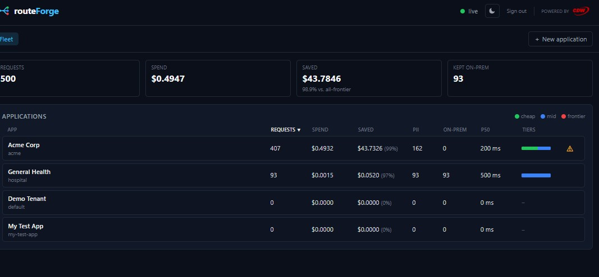
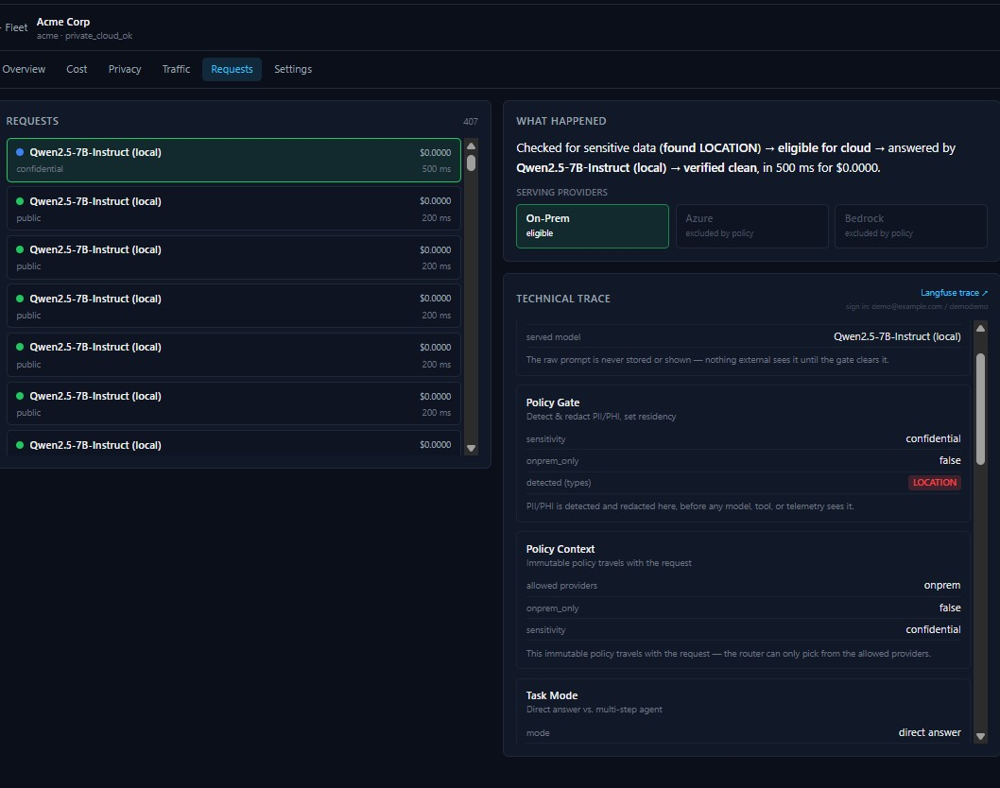

# RouteForge - Smarter LLM Router Application

## 0. What is RouteForge?
> "Every company is being pushed to use AI everywhere. Two things stop them: **cost** —
> sending everything to a frontier model is wildly expensive — and **privacy** — you
> can't put a customer's SSN or a patient record into a public cloud model and hope for
> the best. RouteForge sits in front of your models as a **smart router**. For every
> single request it decides *which* model should answer, *whether* that request is even
> allowed to leave your infrastructure, and it proves — request by request — what it
> decided and why. You keep the cheap, private ones local, and you only pay frontier
> prices when a task actually needs it."

That's the whole pitch. The rest of the demo is evidence.

---

## 1. The problem RouteForge solves

Three pains, in the order customers feel them:

| Pain | What it looks like today | What RouteForge does |
|---|---|---|
| **Runaway cost** | Every call goes to the most expensive model "to be safe." Bills scale linearly with usage. | Routes each call to the cheapest model that can do the job. Most traffic never touches a frontier model. |
| **Privacy / residency risk** | No systematic control over what leaves the building. Compliance is a policy doc, not enforced in the path. | A **policy gate runs first** on every request. Sensitive data is detected and the request is pinned on-prem *before* any model is even considered. |
| **No observability** | You can't answer "why did this request cost that, and did anything leak?" | Every decision is captured as a full trace — model chosen, alternatives rejected and why, cost, latency, and what was redacted. |

---

## 2. The three claims to keep repeating

Everything on screen ladders back to one of these. Say the claim, then point at the number that backs it.

1. **Privacy-first** — sensitive requests never leave the customer's infrastructure. *Enforced by construction, not by a checkbox.*
2. **Cost reduction** — per-call routing sends most traffic to cheap/local models. *~99% cheaper than an all-frontier baseline in this run.*
3. **Observable** — every decision is captured, with PII redacted. *You can audit any single request end to end.*

---

## 2b. Before you start — onboard a model first

RouteForge ships with **no bundled model**: the on-prem pool boots empty by design (a
pure router doesn't carry inference with it — CLAUDE.md hard rule 4). Everything from
section 3 onward assumes an operator has already onboarded at least one OpenAI-compatible
on-prem endpoint (Infrastructure → Onboard, or `POST /admin/infra/models`; see
`docs/guides/onboarding-models.md`) so there's a cheap tier for step 1 of the walkthrough to
land on. Do this **before** the recording starts, off camera — it's a one-time setup
step, not part of the story you're telling the customer. If you skip it, `onprem_only`
traffic (the hospital persona) has no eligible candidate and is rejected outright, not
silently served — which is correct behavior, but not the demo you want to show.

---

## 3. Logging in

**Show:** the sign-in screen → land on the Fleet Overview.

> "RouteForge ships as a self-hosted console — it talks only to our own API, no
> third-party calls, no secrets in the browser. I'll sign in as an admin."

- The console is **admin-gated** — the read views, the config, and the live stream all require a session.
- Once you're in, note the top-right chrome: a **● live** indicator (green when the console has an open real-time stream), a light/dark toggle, **Sign out**, and **Powered by CDW**.

> "See that green **live** dot? The console isn't polling on a timer — requests stream in
> over a live channel and every screen re-totals as they land. What you're about to see is
> real, moving data."

*(If the dot is grey / "disconnected": it's not broken — every screen still loads and refreshes on a 3-second poll, and the live channel auto-reconnects. Don't dwell on it on camera.)*

---

## 4. The Fleet Overview

**Show:** the landing screen.

This one screen tells the whole story. Walk the **four tiles across the top** left to right — these are summed across every application:

| Tile | This run | What to say |
|---|---|---|
| **Requests** | **500** | "Five hundred real requests handled across four applications." |
| **Spend** | **$0.4947** | "What we actually paid to serve all of them — under fifty cents." |
| **Saved** | **$43.7846** — *98.9% vs. all-frontier* | "And here's the headline: had we naively sent all 500 to a frontier model, we'd have spent about forty-four dollars. Routing cut that by **98.9%**." |
| **Kept on-prem** | **93** | "Ninety-three of those requests carried data that policy pinned to on-prem — they provably never left the building." |

> "So on one screen: half a dollar spent instead of forty-four, and ninety-three sensitive
> requests kept local. That's the cost claim and the privacy claim, side by side, in real
> numbers."

### 4a. The per-application table

> "The reason it's a *fleet* view — RouteForge is multi-tenant. Each row is a different
> application, each with its own policy."

Point at the two live apps and contrast them — **this contrast is the best part of the demo:**

**Acme Corp** (`acme`) — a normal SaaS tenant, residency `private_cloud_ok`:
- **407** requests, **$0.4932** spent, **$43.7326 saved (99%)**.
- **162 PII**, but **0 on-prem**, tier bar is mostly **green (cheap)** with some **blue (mid)**.

> "Acme asks everyday questions. Notice 162 of them tripped the PII detector — things like
> a city name or a date, which *are* personal-data entity types — but Acme is a
> cloud-eligible tenant, so those get **redacted and allowed out**, correctly. It's not a
> blunt 'all PII stays local' — it's policy-aware."

**General Health** (`hospital`) — a healthcare tenant, residency `onprem_only`:
- **93** requests, **93 PII**, and **93 on-prem** — *every single one kept local*.
- Tier bar is **blue (mid)**, p50 **500 ms**.

> "Now the hospital. Every request — all 93 — stayed on-prem. This tenant is configured
> `onprem_only`, so it doesn't matter what's in the request; nothing is ever *eligible* to
> leave. That's the residency guarantee, enforced per tenant."

**On the ⚠ warning next to Acme** (be ready for it — it *will* get asked):

> "That amber flag is intentionally cautious — it fires whenever an app had PII-flagged
> requests that didn't all stay on-prem. For a cloud-eligible tenant carrying only
> low-risk entities, that's compliant, not a leak — the indicator is just erring toward
> 'look here.' A high-risk entity like an SSN would have been forced local automatically."

*(The two empty rows — Demo Tenant, My Test App — are just provisioned-but-idle apps. Skip them.)*

---

## 5. One request, end to end — the proof

**Show:** click **Acme Corp** → open the **Requests** tab → click the top request.

> "The dashboard is the summary. This is the receipt. Any single request, I can open and
> see exactly what happened to it — and crucially, *why*."

### 5a. "What happened" — the plain-language band (say this verbatim, it's already English)

> **"Checked for sensitive data (found LOCATION) → eligible for cloud → answered by
> Qwen2.5-7B-Instruct (local) → verified clean, in 500 ms for 0.003¢."**

> "That's the entire lifecycle in one sentence, no jargon. It found a location entity,
> policy said this one *could* have gone to cloud, but the router chose the **local**
> model anyway because it was the cheapest thing that could answer — and then it
> **verified the answer was clean on the way out**."

### 5b. Serving providers — *this grey-out is the privacy story*

Point at the three chips: **On-Prem (eligible, green)**, **Azure (excluded)**, **Bedrock (excluded)**.

> "This is the single most important visual in the product. The cloud providers aren't
> greyed out *after* we picked a model — they were removed from the candidate pool
> **before the router scored anything**. When a request is sensitive, cloud isn't
> 'discouraged,' it's *unreachable by construction*. That's the difference between a
> policy you hope people follow and a guarantee the system enforces."

### 5c. Technical trace — for the technical buyer in the room

Scroll the trace. You don't have to read every card; hit these beats:

- **Policy Gate** — *runs first.* Detected `LOCATION`, set sensitivity `confidential`. "PII is detected and redacted **here**, before any model, tool, or telemetry sees it."
- **Policy Context** — `allowed providers: onprem`. "This immutable policy travels *with* the request — the router can only ever pick from the allowed set. It physically can't break residency downstream."
- **Task Mode** — `direct answer`. "Simple question, single call. A complex task would split into multiple hops, and — this is the key behaviour — **each hop re-runs the router independently**, so a multi-step job can mix cheap and expensive models call by call."
- Call out the honesty rule: **"Notice the raw prompt is never shown."** The console renders entity *types*, never values — a request can literally contain an SSN, and this UI will never display it.

> "So the trace proves three things at once: the gate ran first, the residency lock
> travelled with the request, and we can audit all of it *without* ever exposing the
> sensitive data itself."

---

## 6. Langfuse — the system of record (and where this is going)

**Show:** the **Langfuse trace ↗** deep-link in the trace header.
*(If it bounces to a login, sign in once at the Langfuse host as `demo@example.com` / `demodemo`, then re-click.)*

> "The console is the customer's decision story. **Langfuse** is the operator's permanent
> system of record — every trace, every per-hop span, cost, latency — and it's **PII-
> redacted on export by default**. In that default mode prompts and answers come across as
> null; only the decision attributes are exported. So your audit trail is complete *and*
> safe to keep."

*(Per-app `capture_io` shipped: the default `off` is what's described above — I/O null.
An operator can opt a specific app into `redacted` (masked I/O) or `full` (raw I/O to that
app's **own** provisioned project) — in those modes prompts/answers are **not** null. The
shared project never receives raw I/O, at any setting. `full` additionally requires that
the app has declared a no-protection posture (`policy_mode: "passthrough"`) if it is
`onprem_only`: placement and protection are separate axes since 2026-09-05, so "on my
hardware, and don't touch my data" is a configuration the operator states explicitly rather
than obtains by misdeclaring residency.)*

### 6a. The forward-looking value — custom agent-harness training *(roadmap, say it as roadmap)*

> "Here's where this gets strategic. Every request RouteForge handles is a labelled
> example: *this input, this policy decision, this model, this cost, this outcome.* By
> default we redact that for safety — but you can already **capture the complete input and
> output**, per application, inside your residency boundary (the per-app `capture_io`
> setting, plus a `POST /v1/feedback` endpoint that attaches graded scores to any trace).
> The next step on our roadmap is to turn that captured traffic into an **evaluation and
> training dataset** that improves your own models."

What that unlocks, in plain terms — say one or two, don't list all four:

- **Regression sets** — freeze real traffic and re-run it whenever you change a model or a routing rule, so you catch quality drops before customers do.
- **Routing eval** — measure whether the cheap model was *actually good enough* on the requests it handled, and tune the thresholds with evidence instead of guesswork.
- **Replay** — reproduce any past request exactly to debug it.
- **Custom agent-harness training** — use your own graded traffic to fine-tune and evaluate the agents that run *your* workflows, on *your* data, without it ever leaving your infrastructure.

> "The important part is the boundary. This eval store is a second copy of sensitive
> data, so it stays **residency-local, access-controlled, with a retention limit** — the
> same privacy guarantee that governs the serving path governs the training data. You get
> a self-improving system that never compromises the residency promise."

*(Positioning note for internal use: the **capture** half has shipped — per-app
`capture_io` (`off | redacted | full`) plus `POST /v1/feedback` — so speak of capture in
the present tense. The **training** half is still deliberately future work: RouteForge
serves, observes, and captures; it does not train or auto-promote anything. Building
eval/training pipelines on the captured data is the larger "Improvement Plane" that comes
next. Don't over-promise a ship date on camera.)*

---

## 7. Technical foundation — the open-source stack *(for the technical buyer)*

Have this ready for the engineer in the room. The message: **RouteForge is assembled from
proven open-source and open-standard components — nothing proprietary you can't inspect,
nothing that locks you in.** You can self-host every layer, audit every decision, and swap
any backend.

> "There's no black box here. The router is our logic, but it stands on tools your team
> already trusts — FastAPI, OpenTelemetry, Presidio, NVIDIA's toolkits, vLLM. It runs on
> your Kubernetes, exports to your Langfuse, and speaks the OpenAI API so your existing
> code points at it with a one-line URL change."

### 7a. Serving & routing core (Python 3.12)

| Tool | License | What it does in RouteForge |
|---|---|---|
| **FastAPI** | MIT | The service. Exposes the **OpenAI-compatible** `/v1/chat/completions` serving path plus the admin/console APIs — so any OpenAI SDK points at RouteForge unchanged. |
| **Uvicorn** | BSD | The ASGI web server that runs FastAPI. |
| **Pydantic v2** | MIT | Typed models at every boundary, and the **cross-config validation** that makes a misconfiguration a *boot failure* instead of a silent mistake in production. |
| **PyYAML** | MIT | Loads the four config files (serving / policy / routing / pricing) that make every behaviour switchable with no code change. |
| **httpx** | BSD | Async HTTP client — how the gateway calls model backends and how the traffic generator drives load. |
| **SQLAlchemy (async)** | MIT | The multi-tenant store — applications, API tokens, and per-request usage. **SQLite** for dev/offline, **PostgreSQL** in production (reuses the in-cluster Langfuse Postgres). |
| **argon2-cffi** | MIT | Hashes admin passwords and API tokens (Argon2) — no secrets stored in the clear. |

### 7b. Privacy, routing intelligence & agents

| Tool | License | What it does in RouteForge |
|---|---|---|
| **Microsoft Presidio** (+ **spaCy**) | MIT | **Step 2 — the policy gate.** Detects PII/PHI entities (SSN, name, location, medical IDs…) and drives redaction. This is what runs *first*, before any model sees the request. *(Policy/residency rules on top of it are RouteForge's own logic.)* |
| **NVIDIA NeMo Agent Toolkit** (`nvidia-nat`) | Apache 2.0 | **The agent runtime** for multi-step tasks — state, tools, checkpointing — and the bridge that exports every hop's telemetry to Langfuse. Each agent hop independently re-enters the router. |
| **Headroom** (`headroom-ai`) | open-source | **Step 5 — conditional context compression.** Shrinks tool outputs and history *after* the gate, so the router prices fewer tokens. The second, independent savings lever alongside routing. |

### 7c. Observability

| Tool | License | What it does in RouteForge |
|---|---|---|
| **OpenTelemetry** (SDK + OTLP exporter) | Apache 2.0 | The vendor-neutral telemetry pipeline — every decision becomes a span, exported over a standard protocol (not a proprietary agent). |
| **Langfuse** (self-hosted) | MIT | The operator's **system of record** — traces, per-hop spans, cost, latency, **PII-redacted on export**. Self-hosted, so your audit trail never leaves your infrastructure. |

### 7d. Inference backends (operator-deployed, onboarded at runtime)

RouteForge deploys none of these — an operator stands one up and **onboards** its
OpenAI-compatible endpoint (`POST /admin/infra/models`); there is no `inference_backend` <!-- purged-ok -->
config axis for RouteForge to select among them.

| Tool | License | What it does in RouteForge |
|---|---|---|
| **vLLM** | Apache 2.0 | One common choice for the **on-prem serving path** — the operator runs the open-weight model (e.g. Qwen2.5-7B-Instruct) behind an OpenAI-compatible endpoint and onboards it. |
| **NVIDIA Dynamo + TensorRT-LLM** | Apache 2.0 | Alternative on-prem serving stack an operator can run instead, for GPU load distribution and scaling inference workers across a cluster — onboarded the same way. |

> **Status check 2026-09-10.** The pure-router pivot (2026-08-03) purged the built-in
> demo model and the `inference_backend` config axis <!-- purged-ok --> — there is no
> bundled "mock backend" demo mode any more. If you're demoing without GPU hardware
> at hand, stand up a real (even tiny) OpenAI-compatible endpoint and onboard it; see
> `docs/guides/onboarding-models.md`. Current authority: that doc.

> **Are Azure/Bedrock in this demo?** By default, no — `providers.azure.enabled` and
> `providers.bedrock.enabled` are `false` in `config/serving.yaml`, and a disabled
> provider's model never enters the router's candidate pool at all
> (`app/apps/registry.py::ModelRegistry.effective_pool`), so it can't appear in the
> *rejected* list either. What you see in the request trace instead is the **Serving
> Providers** strip, driven by the request's `allowed_providers` (residency), not by
> the router's actual candidate set — see the Appendix entry "Are those cloud models
> real?" below for what to say if asked.

### 7e. Console UI

| Tool | License | What it does in RouteForge |
|---|---|---|
| **React 18** + **TypeScript** | MIT / Apache 2.0 | The admin console — the fleet view and per-application decision inspector you've been looking at. |
| **Vite** | MIT | Build tool and dev server for the UI. |
| **Tailwind CSS** (+ PostCSS, Autoprefixer) | MIT | Styling. |
| **Recharts** | MIT | The charts — cost-over-time line, tier-mix donut, savings-by-lever bar. |

### 7f. Packaging & deployment

| Tool | License | What it does in RouteForge |
|---|---|---|
| **Docker / Docker Compose** | Apache 2.0 | The whole demo comes up with `docker compose up` — API, UI, Langfuse — in minutes, on a laptop, no GPU. |
| **Kubernetes / Helm** | Apache 2.0 | Production packaging — the same behaviour deploys to **HPE GreenLake / Private Cloud AI** via a Helm chart. |
| **nginx** | BSD | Reverse proxy in the packaged UI image — serves the console and same-origin-proxies the API so the admin session applies. |
| **uv** | Apache 2.0 / MIT | Fast, reproducible Python dependency management and builds. |

> **The one-sentence takeaway for engineering:** *"Open standards end to end — OpenAI API
> in, OpenTelemetry out, running on your Kubernetes with your models. RouteForge is the
> routing brain; everything it stands on is inspectable and replaceable."*

---

## 8. Closing — recap the value in the customer's language

> "So, three things you saw, with real numbers behind each:
>
> 1. **We spent under fifty cents where a naive setup would've spent forty-four dollars** —
>    a 98.9% cut, just from routing each request to the right-sized model.
> 2. **Every sensitive request stayed exactly where policy required** — the hospital
>    tenant kept 100% of its traffic on-prem, enforced *before* any model was chosen, not
>    checked after.
> 3. **You can prove all of it** — any request, end to end, with the sensitive data
>    itself never exposed. And that same trail becomes the dataset that makes the system
>    better over time.
>
> Spend less, leak nothing, prove both — running on your infrastructure, under your
> control."

---

## Appendix — quick answers to likely questions

| They ask… | You say… |
|---|---|
| "Are those cloud models real?" | "In this config, Azure and Bedrock ship **disabled** — a disabled provider never even enters the candidate pool, so it won't show up in the rejected list; what serves every request here is the on-prem endpoint the operator onboarded. The routing proof is the residency filter itself: an `onprem_only` request's Serving Providers strip greys out Azure/Bedrock *before* anything is scored. If you want a live cloud candidate to actually appear and lose in the rejected list — say, to show a `private_cloud_ok` tenant's cost/quality trade-off — enable a real provider with real credentials first; a disabled one can't play that role." |
| "Why is the local cost so low?" | "On-prem tiers are priced at a small representative amortized rate, not literally zero — so the savings read as honest cost *reduction*, not a fake 'free.' A single local request is a fraction of a cent, so the per-request row shows it **in cents** (e.g. `0.003¢`, or `<0.001¢` when it's tinier still) rather than a dollar figure that would round to `$0.0000`." |
| "Is this just PII pattern-matching?" | "Detection is one input. Residency is decided by the entity's **risk class** *and* the **tenant's own policy** — low-risk data on a cloud-eligible tenant is redacted and allowed out; high-risk data, or any request on an `onprem_only` tenant, is forced local." |
| "What about streaming responses?" | "By default we verify the *complete* response before returning it — that's what makes the leakage check trustworthy — so inbound token-streaming is off in this demo config. It's not all-or-nothing, though: a per-app `stream_mode` shipped (e.g. verified-then-stream, or incremental hold-back redaction), and the floor is absolute — an `onprem_only` or verification-required request always falls back to the fully-verified path regardless. The console's own live updates are a separate channel and stay on." |
| "Does it fail open if the gate breaks?" | "No — it **fails closed**. If the policy gate errors, the request is rejected. There is no 'no policy = allow' path." |
| "Why does a multi-step request show 0 ms?" | *(No longer expected — resolved 2026-08-06.)* "That was an old display bug where per-hop latency wasn't summed into the request total; it now sums correctly, so a multi-step request shows its real end-to-end time. If you ever see 0 ms, you're on a pre-fix build." |

---

*Source of truth for the console's every value: `docs/guides/ui-guide.md`. Dashboard-reading
nuances (PII vs on-prem, the ⚠ heuristic): `docs/marketing/demo-dashboard-notes.md`. The eval/
training roadmap: `docs/archive/eval-logging-backlog.md`.*
