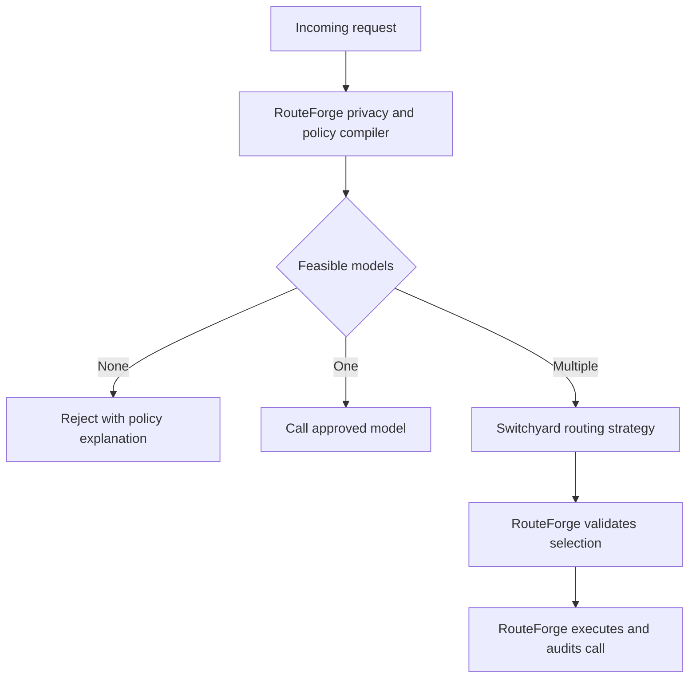

# RouteForge and NVIDIA NeMo Switchyard

## Feature Comparison and Integration Recommendation

**Review date:** November 12, 2026  
**Review method:** Source-code and documentation review. The repositories were not installed or benchmarked as part of this assessment.

### Revisions reviewed

- RouteForge: [`4c62dbd`](https://github.com/mani-mal/routeForge/commit/4c62dbd073bcbbc97e29721b7b5a9cfbeb050755)
- Switchyard: [`559d02d`](https://github.com/NVIDIA-NeMo/Switchyard/commit/559d02d968c850dafaacf80792b14bca283098b9)
- Latest stable Switchyard release reviewed: [`v0.3.0`](https://github.com/NVIDIA-NeMo/Switchyard/releases/tag/v0.3.0)

## Executive recommendation

Integrating Switchyard into RouteForge is a good idea, but Switchyard should be an **optional routing engine inside RouteForge**, not a replacement for RouteForge and not a separate proxy placed in front of it.

The systems solve complementary problems:

- **RouteForge:** Which models are legally, operationally and contractually allowed for this request?
- **Switchyard:** Which of those allowed models is most likely to complete the task efficiently?

RouteForge should continue to own privacy, policy enforcement, feasible-set computation, tenancy, budgets, provider execution and audit records. Switchyard should choose only among candidates that RouteForge has already approved.

## 1. Features that exist in both

| Capability | RouteForge | Switchyard | Important difference |
|---|---|---|---|
| Self-hosted model routing | Production-oriented policy gateway | Embeddable Rust routing library and demonstration server | RouteForge is the gateway. Switchyard is primarily a routing component. |
| Multiple model targets | Routes among registered OpenAI-compatible endpoints | Routes among configured efficient, capable, advisor, classifier and custom targets | RouteForge targets carry deployment and policy metadata. Switchyard targets primarily carry routing roles and capabilities. |
| OpenAI-compatible requests | OpenAI-compatible gateway | Supports OpenAI Chat Completions and Responses | Switchyard also translates Anthropic Messages in its server layer. |
| Cost-aware selection | Cost ceilings, budgets, cost scoring and cost-per-task reporting | Cost-aware algorithms and benchmark comparisons | RouteForge can enforce cost as a hard constraint. Switchyard mainly treats cost as an optimization objective. |
| Quality-aware routing | Quality floors and workload-specific lower bounds | Classifiers, judges, escalation and capable-versus-efficient selection | RouteForge filters by required quality. Switchyard predicts which candidate is likely to be sufficient. |
| Latency-aware routing | Measured latency, availability and provenance-aware scoring | Latency-aware routing and routing-overhead telemetry | RouteForge also considers endpoint health and operational state. |
| Context-aware routing | Context-window checks and trajectory policy state | Request, tool-history and agent-stage-aware algorithms | RouteForge focuses on feasibility and policy. Switchyard focuses on task progress. |
| Eligible-target filtering | Typed feasible set based on privacy, residency, retention, model and application rules | Generic required-label matching on current `main` | Switchyard eligibility is narrower and appears to be unreleased post-v0.3.0 functionality. |
| Fallback behavior | Retries and fallbacks constrained to the feasible set | Fallback targets and escalation paths | RouteForge has stronger guarantees that fallback cannot escape policy eligibility. |
| Evaluation support | FeasibleRouteBench and traffic-weighted counterfactual simulation | Terminal-Bench, DeepSWE, soak tests and algorithm benchmarks | RouteForge evaluates policy-constrained routing. Switchyard evaluates task success and cost efficiency. |
| Decision evidence | Recomputable traces and signal provenance | Routing evidence, algorithm signals and OpenTelemetry spans | RouteForge is stronger for policy auditability. Switchyard exposes richer algorithm-specific signals. |
| OpenTelemetry | Supported | Supported | RouteForge also supports per-application Langfuse integration. |
| Model capability metadata | Context, tool, deployment and quality attributes | Context, tool, reasoning, vision and routing-role attributes | The metadata is used for different purposes but can be mapped through an adapter. |
| Apache 2.0 license | Yes | Yes | The licenses are technically compatible, subject to notice, attribution and legal review requirements. |

## 2. Features that currently exist in only one repository

| RouteForge-only capability | Switchyard-only capability |
|---|---|
| Policy compiler that computes the feasible set before scoring | Broad collection of learned and agent-aware routing algorithms |
| PII/PHI detection and redaction | LLM task-classifier routing |
| Data-residency and geographic-placement rules | Stage routing based on tool calls and recent agent activity |
| Retention, provider, model and application policy controls | Composite task-classifier plus stage router |
| Fail-closed behavior when no compliant model exists | Escalation router that starts with an efficient model and promotes after failure |
| Minimal conflicting-core explanations for unsatisfied policies | Advisor Gate, where a stronger model reviews or requests a redo |
| Noninterference property-testing harness | Verification-Gated Routing on current `main` |
| Persistent trajectory policy envelope shared across replicas | Experimental hidden-state prefill router |
| Monotonic policy tightening over a conversation or task | Sub-agent routing |
| Multi-tenant applications, teams and API tokens | Reasoning-effort selection per target |
| Per-application budgets and quotas | Rust core with Python, TypeScript and Go bindings |
| Admin console and model-onboarding workflow | Anthropic Messages protocol translation |
| Endpoint probing, health checks and circuit breakers | Decision-only routing endpoint |
| Production retries and provider failover | OpenRouter and NeMo Relay integrations |
| Output-leakage checks and response verification | Published Terminal-Bench and DeepSWE routing results |
| Semantic response cache | Algorithm-specific metrics such as classifier failure and advisor discarded tokens |
| Headroom and local context compression | Speculative workflows and caller-owned state on unreleased `main` |
| Artificial Analysis metric ingestion and air-gapped import | Direct orchestration of classifier, judge and advisor calls |
| Traffic-weighted policy counterfactual simulator |  |
| FeasibleRouteBench policy-constrained oracle |  |
| Kubernetes, Helm and production gateway deployment assets |  |

## 3. Why the integration fits RouteForge

RouteForge already defines a routing-strategy abstraction that anticipates a future Switchyard strategy. The natural division of responsibility is:

1. RouteForge authenticates the caller and resolves the application and tenant.
2. RouteForge detects sensitive content and compiles the applicable policy.
3. RouteForge computes the feasible set and applies hard quality, context and cost limits.
4. If no candidate remains, RouteForge rejects the request with a policy explanation.
5. If one candidate remains, RouteForge selects it without invoking Switchyard.
6. If multiple candidates remain, Switchyard chooses or ranks only those candidates.
7. RouteForge validates the returned model and fallback list against the feasible set.
8. RouteForge executes the provider call and records the complete decision trace.



## 4. Recommended ownership boundary

### RouteForge should own

- Authentication and multi-tenancy
- PII/PHI handling and redaction
- Residency, retention, provider and application rules
- The authoritative feasible set
- Budgets, quotas and minimum quality requirements
- Persistent task and trajectory policy state
- Provider credentials and model invocation
- Endpoint health, retries, failover and circuit breakers
- Output checks and the final audit record

### Switchyard should own

- Choosing among the feasible targets
- Stage and task classification
- Capable-versus-efficient model selection
- Escalation, advisor and verification logic
- Algorithm-specific routing evidence

Every classifier, judge or advisor invocation initiated by Switchyard must be executed through RouteForge. These internal calls can contain the same sensitive data as the original request, so they require independent policy checks, budget accounting and audit records.

## 5. Important integration risks

### 5.1 Do not use `switchyard-server` as the production gateway

Switchyard describes its server as a demonstration and local-evaluation component. Its supported production pattern is embedding the Rust `libsy` core into a host. RouteForge should remain the production gateway.

### 5.2 Avoid the LiteLLM integration as the primary bridge

Switchyard's LiteLLM integration is experimental and does not support every intermediate call required by classifier and escalation algorithms. RouteForge already uses LiteLLM behind its policy boundary. Adding another LiteLLM routing layer would complicate policy enforcement and tracing.

Use the Switchyard Python binding or a small native adapter instead.

### 5.3 RouteForge's current strategy interface is too narrow for advanced algorithms

The current RouteForge `rank()` interface is synchronous and assumes that a strategy ranks an existing candidate set. This is sufficient for:

- Auto or Stage routing
- Random routing
- Decision-only routing
- Shadow evaluation

It is not sufficient for algorithms that require asynchronous model calls, including:

- Task classifier
- Escalation judge
- Advisor Gate
- Verification-Gated Routing

These algorithms require a second asynchronous orchestration interface that can request a policy-controlled internal model call through RouteForge.

### 5.4 Do not replace RouteForge trajectory policy with Switchyard eligibility labels

Switchyard's current-main eligibility system supports trusted labels and monotonically accumulated task requirements. Its documented limitations include in-memory state, lack of replica persistence, no expiry and no built-in policy meaning.

RouteForge's trajectory state is database-backed, application-scoped, expiring and designed for policy enforcement. It should remain authoritative.

### 5.5 Pin the Switchyard dependency

Switchyard is pre-1.0 and has introduced breaking changes. For an initial experiment, pin a tested release such as:

```text
nemo-switchyard==0.3.0
```

Do not build production integration against the moving `main` branch. Reassess the newer eligibility, caller-owned state and verification features after they are included in a stable release.

### 5.6 Validate packaging for customer environments

RouteForge uses Python while Switchyard contains a native Rust core. The integration should be tested for:

- Supported CPU architectures and instruction sets
- Python and wheel compatibility
- Container image size and startup behavior
- Air-gapped installation and artifact mirroring
- DGX, Kubernetes and customer on-premises environments

## 6. Recommended implementation plan

### Phase 1: Safe shadow experiment

- Add an optional `SwitchyardRoutingStrategy`.
- Start with Auto or Stage routing, which does not require additional classifier calls.
- Give Switchyard only RouteForge-approved candidates.
- Record Switchyard's proposed choice without changing production traffic.
- Compare the proposed choice with the current RouteForge selection.
- Store Switchyard's evidence inside the RouteForge decision trace.

### Phase 2: Controlled production routing

- Enable Switchyard for selected applications through a feature flag.
- Route a small percentage of traffic through it.
- Revalidate every selected model and fallback against the original feasible set.
- Fall back to RouteForge's existing strategy if Switchyard fails or exceeds its latency budget.
- Allow application owners to opt in separately because workloads may benefit differently.

### Phase 3: Advanced routing algorithms

- Add an asynchronous policy-safe callback for classifier, judge and advisor calls.
- Treat every intermediate call as a first-class RouteForge request.
- Charge its tokens and cost to the originating application and task.
- Apply residency, retention and privacy policy independently to each intermediate call.
- Prevent recursive re-entry into Switchyard when RouteForge executes one of these internal calls.

## 7. Pilot evaluation plan

Compare the following strategies on representative RouteForge customer traffic:

1. Always use the capable model
2. Always use the efficient model
3. Existing RouteForge default strategy
4. Random selection between the two models
5. Switchyard Auto or Stage within the RouteForge feasible set

Use RouteForge's traffic-weighted counterfactual simulator for offline analysis, followed by shadow evaluation and a limited online experiment.

### Go/no-go criteria

| Requirement | Target |
|---|---|
| Final selection outside the RouteForge feasible set | Zero |
| Classifier, judge or advisor call outside its feasible set | Zero |
| Policy-violating fallback | Zero |
| Task success | Within a predefined noninferiority margin of the existing router |
| Cost per successful task | Lower than the existing router |
| Routing latency | Within each application's SLO |
| Behavior after endpoint failure | Deterministic and policy compliant |
| Behavior across replicas and restarts | State remains correct and reproducible |
| Decision-trace coverage | Final choice, alternatives, signals, fallbacks and internal calls recorded |

## 8. Product value for RouteForge customers

The integration can provide tangible customer value when exposed as an optional feature:

- Lower cost per successful agent task
- Automatic use of efficient models for routine steps
- Promotion to a stronger model when tools fail or task difficulty increases
- Workload-specific routing without weakening enterprise policy
- Auditable explanations for both policy eligibility and model selection
- A safe way to experiment with learned routing in on-premises and regulated environments

The customer-facing explanation should remain simple:

> RouteForge first determines which models are permitted. The optional adaptive router then selects the best permitted model for the current task stage.

## 9. Research and arXiv opportunity

The integration can strengthen the RouteForge paper if evaluated as a separation between **hard feasibility** and **adaptive optimization**.

Potential research questions include:

1. Does learned routing retain its cost and quality benefit when choices are restricted by changing enterprise policies?
2. Can noninterference properties guarantee that adding an adaptive router does not change policy eligibility?
3. How should classifier, judge and advisor calls be incorporated into the feasible set and total task cost?
4. Does trajectory-level policy tightening change the optimal agent-stage routing strategy?
5. How do policy constraints affect the regret of learned routing compared with unconstrained routing?

A useful paper experiment would compare unconstrained Switchyard, RouteForge-only routing, and policy-constrained Switchyard within RouteForge. Measurements should include task success, total task cost, routing overhead, constraint violations, fallback violations and counterfactual policy impact.

## 10. Final decision

**Proceed with a limited integration pilot.**

The safest first implementation is a pinned Switchyard Auto or Stage strategy that operates after RouteForge computes the feasible set. Start in shadow mode, preserve RouteForge as the policy and execution authority, and add advanced classifier or advisor algorithms only after a policy-safe asynchronous call interface is available.

## Primary sources

- [RouteForge README](https://github.com/mani-mal/routeForge/blob/4c62dbd073bcbbc97e29721b7b5a9cfbeb050755/README.md)
- [RouteForge routing strategy interface](https://github.com/mani-mal/routeForge/blob/4c62dbd073bcbbc97e29721b7b5a9cfbeb050755/app/routing/strategy.py)
- [RouteForge trajectory policy](https://github.com/mani-mal/routeForge/blob/4c62dbd073bcbbc97e29721b7b5a9cfbeb050755/app/policy/trajectory.py)
- [Switchyard README](https://github.com/NVIDIA-NeMo/Switchyard/blob/559d02d968c850dafaacf80792b14bca283098b9/README.md)
- [Switchyard routing algorithms](https://github.com/NVIDIA-NeMo/Switchyard/blob/559d02d968c850dafaacf80792b14bca283098b9/docs/routing_algorithms/overview.md)
- [Switchyard host integration](https://github.com/NVIDIA-NeMo/Switchyard/blob/559d02d968c850dafaacf80792b14bca283098b9/docs/reference/host_integration.md)
- [Switchyard target eligibility](https://github.com/NVIDIA-NeMo/Switchyard/blob/559d02d968c850dafaacf80792b14bca283098b9/docs/internal/target-eligibility.md)
- [Switchyard benchmarks](https://github.com/NVIDIA-NeMo/Switchyard/blob/559d02d968c850dafaacf80792b14bca283098b9/docs/benchmarks.md)
- [Switchyard installation](https://github.com/NVIDIA-NeMo/Switchyard/blob/559d02d968c850dafaacf80792b14bca283098b9/INSTALLATION.md)
