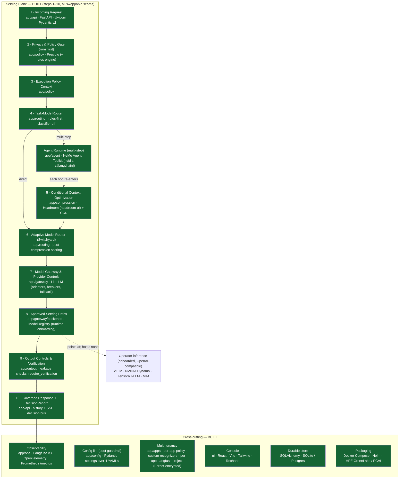
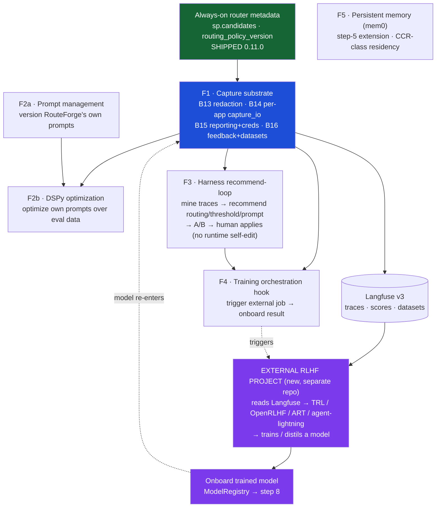

# Program roadmap — self-improving / cost-reduction feature set

**Date:** 2026-08-18
**Status:** roadmap (umbrella spec); indexes the per-feature specs below
**Rationale & boundary:** `docs/architecture/self-improving-agent-feature-fit.md` (CAN/CAN'T
verdicts + the control-plane-vs-compute boundary, owner-ratified 2026-08-17)
**Governs:** CLAUDE.md rule #4 amended 2026-08-17 (Improvement Plane *orchestrated, not hosted*)

This is the map for the whole feature set the owner scoped from the research bundle (mem0,
DSPy, meta-harness/RSI, RLHF libs). Each feature gets its **own** detailed spec + implementation
plan when its dependencies are met; this doc fixes **what** is built, in **what order**, and
**why that order**. It builds nothing itself.

---

## 1. The one boundary (repeat, because it governs every feature)

**RouteForge captures data, routes calls, and pulls cost levers. It orchestrates and consumes;
it hosts no heavy compute.** It points at inference (hosts none) and orchestrates training
(hosts none). A model enters only via **onboarding**. Runtime self-modification is refused. See
the feature-fit doc for the full derivation.

Cost-reduction levers, all serving-plane: **compression (shipped)** · prompt-opt · memory ·
routing-to-cheaper/distilled models. Improvement loop: **capture → recommend/export → (human
gate) → external train → onboard → measure**.

---

## 2. System maps

### 2.1 What's already built — the Serving Plane + cross-cutting infra (OSS labelled)

> NeMo Guardrails and OPA-style rules are the gate's per-CLAUDE.md design; Presidio + the
> in-repo rules engine + custom recognizers are what's wired today. `nat_tools` is a local
> editable shim. The `presidio`, `observability`, `compression`, and `postgres` Python extras are
> opt-in (`uv sync --extra …`).

### 2.2 The improvement layer — planned features + the external RLHF project

The new RLHF project is a **separate repo** the owner is creating. RouteForge never trains; it
**produces the Langfuse substrate** the RLHF project reads, and **consumes the trained model back
via onboarding** (step 8). That import path is the only way a model re-enters — the loop closes
without RouteForge hosting any training compute.

**Reading it:** metadata (done) + **F1 capture substrate** are the trunk everything reads from.
F2b/F3/F4 consume F1's exported datasets + feedback via Langfuse. F2a (prompt *management*) and
F5 (memory) **don't** hard-depend on F1 and can run in parallel. The **external RLHF project**
sits entirely outside RouteForge (purple): it reads Langfuse, trains, and hands a model back
through onboarding — F4 is RouteForge's side of that handshake (trigger + consume), nothing more.

---

## 3. The features

### F1 — Capture substrate (B13 → B16)  ·  **spec written**
`docs/superpowers/specs/2026-08-17-capture-substrate-design.md`
Honest redaction (B13), per-app `capture_io` tri-state with strict residency lint (B14),
admin cross-app reporting + manual per-app Langfuse creds (B15 remainder), and feedback +
dataset-export substrate (B16). **The trunk — do first.** Metadata already always-on.

### F2a — Prompt management  ·  spec TODO
Version + store + activate RouteForge's **own** internal prompts (step-4 classifier,
verify/judge templates). Lighter than F2b, **independent of F1** — can start anytime. Gives us a
`prompt_version` to A/B, mirroring `routing_policy_version`. Not customer prompts.

### F2b — DSPy prompt optimization  ·  spec TODO (**after F1 + F2a**)
Optimize the managed prompts with DSPy against a metric over **exported eval data** (F1's
datasets + feedback). Offline, human-gated, versioned; the operator promotes the winning prompt.
Needs F2a (something to version) and F1 (data to optimize against).

### F3 — Harness recursive-learning recommend-loop  ·  spec TODO (**after F1**)
Mine Langfuse traces (Judge Agents) → detect wrong/suboptimal routing → **recommend**
routing-rule / threshold / prompt changes → version + A/B on `routing_policy_version` → operator
applies via config, lint gates. **Offline + human-gated; no runtime self-editing** (refused).
Extends F1's trace-mining.

### F4 — Training orchestration hook  ·  spec TODO (**after F1**, wants F3)
RouteForge's side of the handshake with the **external RLHF project** (separate repo). Trigger a
distill/fine-tune job (TRL / OpenRLHF / ART / agent-lightning) from F1's exported datasets, track
it, and **onboard the resulting model** as an on-prem endpoint. Hosts no training compute. Closes
the loop. `full`, residency-local data required (F1 Phase B/C guarantees the topology). The RLHF
project owns the training; F4 owns only *trigger + consume*.

### F5 — Persistent memory module (mem0)  ·  **own residency spec first**, then build
RouteForge-owned memory as a step-5 (Conditional Context Optimization) extension — retrieve
relevant memories instead of replaying history (token/cost lever). **Inherits CCR rules
verbatim** (#6/#7): in-boundary, TTL, redacted, post-gate content only, disabled if residency
unprovable. Newest/least-specified surface → design its residency model before any build.
Independent of F1.

---

## 4. Recommended build order

1. **F1 capture substrate** (trunk) — spec ready; start here.
2. **F2a prompt management** — can run in parallel with F1 (independent); cheap, unlocks A/B.
3. **F3 recommend-loop** and **F2b DSPy optimization** — after F1 (need exported data); F2b also
   needs F2a.
4. **F4 orchestration hook** — after F1 (+ F3 signal). The loop-closing step.
5. **F5 memory** — independent track; sequence by owner priority, but **residency spec first**.

Only F1 has a ratified detailed spec today. Each other feature's spec is authored when we reach
it (or sooner for the independent tracks F2a/F5 if prioritized).

---

## 5. What is NOT on this roadmap (declined / out of scope)

- **Hosting** training or inference compute (GPUs, in-process TRL) — control-plane only.
- **Runtime self-editing harness** (Exo "collapse the loop", Guardian rebuild-and-soak) —
  un-auditable; breaks fail-closed + deterministic routing.
- **Auto-applying** mined recommendations or auto-promoting models — human gate always.
- **Optimizing/rewriting customer prompts** — not ours; they pass through.
- **In-process reward modelling / eval gates / promotion** — Improvement Plane, external.

See `self-improving-agent-feature-fit.md` §2 for the per-theme reasoning.
